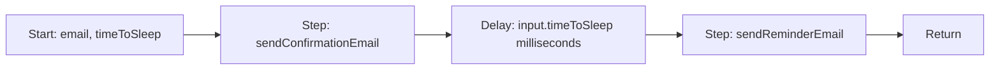
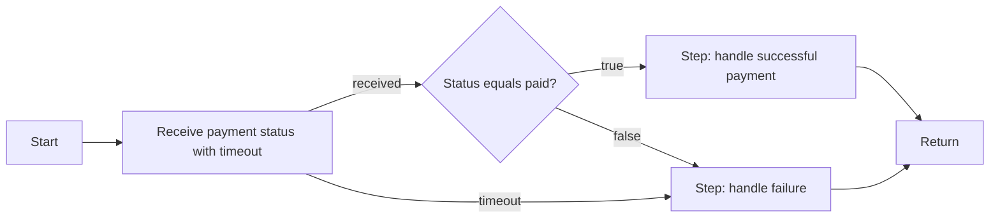
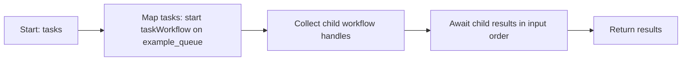
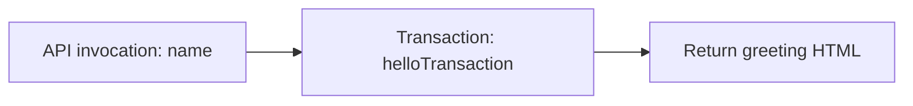

# Deriving the node model from DBOS programs

This source-backed model is implemented as schemaVersion 2 in the existing StackProc canvas, with a separate DBOS-native interpreter. Legacy/unversioned graphs continue through the v1 interpreter. The tables below record the design vocabulary; the implementation status and boundaries are listed here.

Implemented: 16 operation kinds, typed JSON bindings, named control outcomes, embedded/saved child snapshots, per-item/per-iteration execution IDs, scoped collection/loop/parallel operations, datasource transaction adapters, queue resources and partition bindings, cron schedules, keyed debounce invocation, delayed queue dispatch, persisted parent/child traces and nested graph editing. 15 runnable source-derived fixtures live in `lib/native/examples.ts`. Advanced bindings/resources currently use validated JSON fields in the inspector.

Current boundaries: joins collect all results, loops use a predicate plus a maximum iteration count, there are no explicit break/continue ports, and streams/first-result joins/queue rescheduling are not implemented. Arbitrary domain/provider operations require trusted handlers. This is a local application without multi-user auth.

The goal is to represent DBOS execution faithfully across domains. StackProc's canvas supplies editing interactions and rendering. Its AI-oriented palette must not determine the runtime vocabulary.

The supplied Transaction Director and demo-app repositories are now cloned and reviewed in the [example reference catalog](example-reference-catalog.md). That catalog adds concrete source evidence for nested workflows, iteration, compensation, progress events, queue policies, and stateful loops.

## Sources examined in this checkout

| Source                                                 | What it establishes                                                                                                                                      |
| ------------------------------------------------------ | -------------------------------------------------------------------------------------------------------------------------------------------------------- |
| `README.md`, durable workflows example                 | Two ordinary operations checkpointed with `DBOS.runStep` inside a registered workflow.                                                                   |
| `README.md`, durable scheduling examples               | Cron is registered around a workflow after launch; a reminder workflow contains two steps separated by `DBOS.sleep`.                                     |
| `README.md`, durable notifications example             | `DBOS.recv` produces a message or `null` on timeout; ordinary TypeScript conditions route the result.                                                    |
| `README.md`, durable queues example                    | A loop starts child workflows on a queue, retains handles, then a second loop awaits their results. All children are started before collecting results.  |
| `packages/create/templates/dbos-prisma/src/main.ts`    | A registered datasource transaction has a distinct execution boundary. Express routing is application ingress, not a durable operation inside the graph. |
| `tests/decorator-free.test.ts`                         | Decorators and function registration are alternative authoring styles, not different node types; child workflow handles and queue dispatch are explicit. |
| `tests/concurrency.test.ts`, `tests/streaming.test.ts` | Messages, events, child workflows, streams, and concurrency need their own execution semantics.                                                          |
| `src/dbos.ts`, `src/step.ts`, `src/wfqueue.ts`         | Actual API contracts, step policies, timeout behavior, workflow handles, and queue configuration.                                                        |

## Separate four concerns

1. **Execution primitives:** durable step, datasource transaction, child workflow call, durable sleep, message send/receive, event publish/wait, and stream operations.
2. **Control flow:** decision, parallel branches and join, map over a collection, loop, and return. These come from TypeScript structure; they are not invented SDK operations.
3. **Invocation and resources:** manual/API/schedule invocation, registered handlers, datasource connections, queue concurrency/rate limits, and workflow references. A queue is a dispatch resource, not an action that does work by itself. A schedule invokes a workflow; it is not a step inside that workflow.
4. **Domain capabilities:** HTTP requests, email, payments, clinical processing, LLM calls, and other operations. Most are registered step handlers. A human approval is a reusable composition of durable receive, decision, and application-owned approval records.

Retries, backoff, and per-attempt timeouts belong to execution policy. They should not become decorative extra nodes. Error handling and compensation can be represented as explicit control-flow paths when the original program has them.

## Candidate semantic nodes

| Node                   | Configuration                                                   | Runtime boundary                                                                                                                                     |
| ---------------------- | --------------------------------------------------------------- | ---------------------------------------------------------------------------------------------------------------------------------------------------- |
| Start                  | Input schema and invocation metadata                            | Workflow arguments.                                                                                                                                  |
| Step                   | Registered handler reference, input bindings, `StepConfig`      | `DBOS.runStep`.                                                                                                                                      |
| Transaction            | Registered datasource operation, input bindings                 | Datasource transaction API; never wrap the transaction inside an ordinary step.                                                                      |
| Call workflow          | Workflow reference, arguments, optional queue, await/start mode | Registered workflow invocation or `DBOS.startWorkflow`; start mode outputs a workflow handle.                                                        |
| Await workflow results | Handle(s), collection/all/first behavior                        | Handle `getResult`, `DBOS.waitAll`, or `DBOS.waitFirst` as appropriate. These methods return different shapes; do not conflate handles with results. |
| Delay                  | Duration binding with explicit units                            | `DBOS.sleep`, at workflow level.                                                                                                                     |
| Send message           | Destination workflow ID, topic, value                           | `DBOS.send`.                                                                                                                                         |
| Receive message        | Topic and timeout/deadline                                      | `DBOS.recv`, at workflow level; distinguish received data from timeout.                                                                              |
| Publish event          | Key and value                                                   | `DBOS.setEvent`.                                                                                                                                     |
| Wait for event         | Workflow ID, key, timeout/deadline                              | `DBOS.getEvent`; unlike receive, an event is not a consumed queue message.                                                                           |
| Decision               | Typed predicate and named outcomes                              | Deterministic control flow. No arbitrary `eval`.                                                                                                     |
| Parallel / join        | Scoped branches and join semantics                              | Structured concurrency; explicitly distinguish all from first completion.                                                                            |
| Map                    | Collection binding, scoped per-item graph, collection result    | Structured iteration. Starting children and awaiting their results are separate operations.                                                          |
| Loop                   | Scoped body, predicate, termination policy                      | Structured iteration; do not introduce an unbounded back-edge into the inherited once-per-node DAG executor.                                         |
| Return                 | Output bindings/schema                                          | Workflow return value.                                                                                                                               |

Streams should be modeled from the SDK's read/write/close examples in a separate pass, rather than silently collapsing stream operations into ordinary step outputs.

## Graph contract

The successor graph needs a versioned semantic layer, distinct from its canvas layout:

- A discriminated node type determines runtime behavior. An AI model operation is a specialization of a step, not the universal execution unit.
- Named control ports express `success`, `error`, decision outcomes, and timeout where applicable. Left/right/top/bottom are visual anchors, not execution outcomes.
- Typed input/output ports and explicit bindings describe data movement separately from execution order. Bindings reference workflow input, upstream outputs, literals, or approved pure expressions.
- Structured subgraphs represent map bodies, loops, and parallel scopes. A flat DAG alone cannot express the DBOS queue example's dynamic task count.
- Referenced workflows, queues, handlers, and datasources are versioned resources. Graph JSON references trusted server code; it does not contain executable source.
- UI metadata holds positions, collapsed groups, and visual style. Moving a node does not change program semantics.
- The existing unversioned StackProc graph needs an explicit migration adapter. Saved graphs and in-flight snapshots must not be silently reinterpreted under new semantics.

## Represent the examples before generalizing

### 1. Reminder

Source: the README's `reminderWorkflowFunction`.

This is the first small vertical slice for the native model. It proves that a durable wait is a workflow operation, not a handler hidden inside `runStep`.

### 2. Payment notification

Source: the README's `billingWorkflowFunction`.

The original sample leaves the business handlers as comments. The graph should reference application-provided handlers rather than inventing payment behavior. Timeout and non-paid messages both reach the original failure path.

### 3. Queued tasks

Source: the README's `queueFunction`.

`example_queue` is a workflow-dispatch resource whose configuration lives outside the graph's sequence. Do not translate the two loops into a single map body that starts **and immediately awaits** each task: that would serialize execution and change the program.

### 4. Transaction-backed greeting

Source: the Prisma quickstart template.

Prisma client setup, database configuration, Express, and HTML styling remain application resources/presentation. The transactional operation is the durable boundary represented in the workflow.

## Additional examples and their contracts

The document ingestion graph models the Python `document-detective` hierarchy: enqueue all documents, parse one document into pages, index each page, then collect totals. Its local adapter accepts inline text/pages and creates a real Postgres full-text index; PDF download, vector embeddings and RAG chat are provider adapters outside this fixture.

A native `review` operation adds application-owned reviewer records plus a durable receive, timeout/expiry and existing Resolve UI. The human-in-the-loop graph publishes status and branches on the decision. Customer refunds add a price-policy decision, real local purchase updates and a detached review child.

The outbox graph follows `atomic_workflow.py`: commit order, publish ID, deliver an idempotent local notification, update sent status. It does not claim support for the separate SQL transactional enqueue variant. The worker graph invokes a queued bounded job; the deployment graph serializes jobs and publishes stage events; the mirror graph filters keys and launches background copies using queue/worker limits. External Slack, deployment, AWS and model integrations remain trusted adapter implementations. The research graph searches a supplied corpus and carries findings/query history through bounded passes.

## Verification criteria

1. Author these source-derived graphs as versioned fixtures.
2. Validate ports, bindings, referenced resources, and structured scopes before starting a run.
3. Render the same fixtures with the existing canvas via a visual projection or evolved renderer.
4. Execute the reminder and notification fixtures using actual DBOS workflow-level operations; verify recovery while sleeping and waiting for a message.
5. Execute the queued-task fixture with several task inputs; prove children start before result collection and results preserve input order.
6. Add a datasource adapter test for the transaction fixture.
7. Keep node status, persisted events, and graph snapshots consistent across the native interpreter and UI.

This follows the order: **DBOS example → execution semantics → node/port model → graph fixture → renderer/interpreter validation**. Adding attractive node cards before those contracts are known reverses that order.

## Provider integration design

The customer control plane and node integration contracts are mapped in [Provider node abstraction and offerings](provider-node-abstraction.md). Account Management informs customer/user onboarding, credentials, connections and run auditing. Vercel AI, CrewAI and related frameworks supply execution capabilities; external services supply integration nodes inspired by n8n. Nodes reference control plane connections. The design also covers checkpoint ownership, Python workers, streaming and handoffs.
