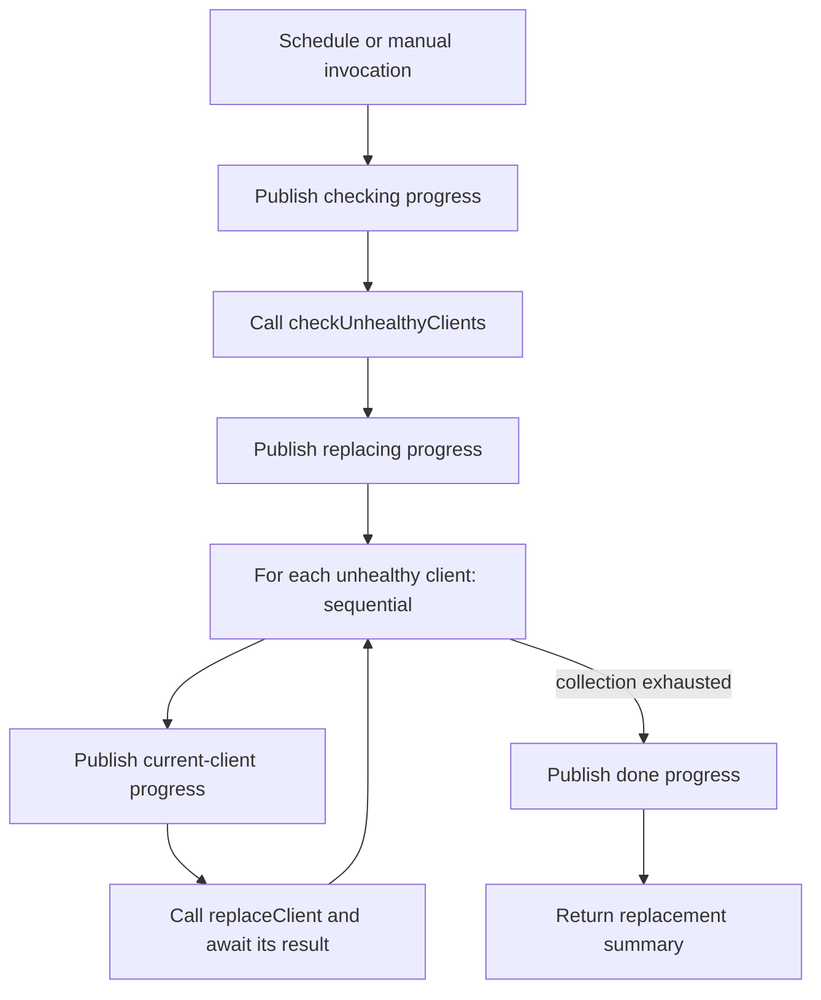

# Example reference catalog

Initial source review of the two repositories supplied for designing the DBOS-native node model. Both are cloned beside this SDK checkout. This pass reads source; it does not launch the examples or configure their external services.

## Pinned checkouts

| Repository                | Local directory relative to the SDK | Branch | Reviewed commit                            |
| ------------------------- | ----------------------------------- | ------ | ------------------------------------------ |
| `dbos-inc/txd-dbos`       | `../txd-dbos`                       | `main` | `cdf79a6284a9222ce5b953fc460767f1f22b6fe7` |
| `dbos-inc/dbos-demo-apps` | `../dbos-demo-apps`                 | `main` | `5568fc9fdb61a91e6f7cb300ef6f1cd254d219a6` |

## Transaction Director: a useful canonical workflow

Source: `txd-dbos/main.go`, especially `autoscalingWorkflow`, `checkUnhealthyClients`, and `replaceClient`.

This Go application supplies a domain example independent of AI. The same execution semantics can guide our TypeScript graph representation; the Go functions themselves are not directly executable by our TypeScript runtime.



The repeated arrows above describe structured iteration, not a back-edge supported by the current DAG interpreter.

`checkUnhealthyClients` contains a per-client health-check step, a decision, and an accumulator that filters the input collection. `replaceClient` is a child workflow with this sequence:

```text
decommissionClient → startNewMachine → runStartupScript → registerNewClient → return new client ID
```

Model requirements demonstrated:

- Reusable child workflow definitions with independently bound inputs and outputs.
- A sequential collection scope with item/index bindings, filtering, and result accumulation.
- Durable step boundaries around external operations.
- Progress events as explicit workflow operations.
- A schedule and manual action that invoke the same workflow definition.
- Error propagation from a child workflow to its parent.

The infrastructure operations in this demo are stubs that sleep and print. The workflow structure, scheduling, child calls, and DBOS event operations are the reference; the stubs should not become invented real infrastructure integrations.

## TypeScript reference set

| Example and source                                   | Observed behavior                                                                                                                                                                                                           | Implication for the model                                                                                                                          |
| ---------------------------------------------------- | --------------------------------------------------------------------------------------------------------------------------------------------------------------------------------------------------------------------------- | -------------------------------------------------------------------------------------------------------------------------------------------------- |
| `typescript/dbos-node-toolbox/src/main.ts`           | Two `runStep` calls; queued child starts followed by result collection; scheduled workflow; Knex transactions                                                                                                               | Small fixtures for the foundational execution primitives. Preserve transaction boundaries separately from steps.                                   |
| `typescript/widget-store/src/main.ts`, `src/shop.ts` | Inventory reservation transaction with an error exit, order creation, payment event publication, message wait, paid/failed branching, inventory restoration, background dispatch workflow, progress transactions and sleeps | Error exits, business compensation, receive timeout, event output consumed by external clients, and child start without awaiting completion.       |
| `typescript/queue-worker/worker.ts`, `server.ts`     | Repeated steps with progress events; separately submitted worker execution                                                                                                                                                  | Distinguish workflow definition, invocation service, worker execution, and progress subscriptions.                                                 |
| `typescript/queue-patterns/src/main.ts`              | Partitioned fair queueing, queue rate limits, keyed debouncing, delayed enqueue and rescheduling                                                                                                                            | Queue and invocation policies are resources/dispatch configuration. Delayed enqueue is distinct from sleeping inside an already-running workflow.  |
| `typescript/hacker-news-agent/src/workflows.ts`      | Bounded research loop, nested query workflow, accumulated history, model-backed decisions, alternative queries, `continue`/`break`, final synthesis                                                                         | Structured loops need loop state, termination paths, accumulators, and per-iteration identity. Model calls remain registered step implementations. |

The TypeScript sources were inspected directly. No model/API calls were made.

The Python sources highlighted in the DBOS gallery have now been reviewed and mapped into local runnable graphs:

| Source                                                | Graph requirements represented                                                                | Local adapter boundary                                                                          |
| ----------------------------------------------------- | --------------------------------------------------------------------------------------------- | ----------------------------------------------------------------------------------------------- |
| `document-detective/document_detective/main.py`       | Queue documents before collection; per-document parse; sequential page indexing; page totals  | Inline text/pages and Postgres full-text index; PDF/LlamaIndex/embeddings/RAG are not connected |
| `agent-inbox/main.py`                                 | Status events, durable human review, approve/deny/timeout                                     | Existing local Resolve form and Postgres reviewer records                                       |
| `transactional-outbox/atomic_workflow.py`             | Order transaction, published ID, notification and sent-status transaction; crash gap recovery | Local orders and idempotent notification delivery records                                       |
| `transactional-outbox/transactional_enqueue.py`       | SQL enqueue and order commit in a single transaction                                          | Reviewed separately; this SQL variant is not implemented by the outbox fixture                  |
| `reliable-refunds-langchain/reliable_refunds/main.py` | Purchase lookup, threshold policy, automatic refund or detached human review; status updates  | Real local purchase records; no model, SendGrid or payment calls                                |
| `deploy-tracker-slackbot/main.py`                     | Serialized queue, build/test/deploy stages, status events and notifications                   | Simulated stages plus persisted local notifications; no Slack or deployments                    |
| `s3mirror/app/main.py`                                | Filter existing keys, queued background copies, global/worker limits, task ID event           | Supplied object inventory and local object copies; no AWS, cancellation or throughput UI        |

The added Hacker News research fixture uses supplied articles to exercise query history and accumulated findings. It is a source-pattern graph, without live agent reasoning or search services.

## Design consequences

1. **A node is a definition, not one execution.** A repeated health-check or research step needs an execution identity including its enclosing scope and iteration. The current executor's `Set<nodeId>` cannot represent that.
2. **The model needs structured scopes.** Preserve sequential iteration, bounded loops, parallel scopes, and child workflow definitions. Flattening everything into a once-per-node DAG changes the source programs.
3. **Starting and waiting are different.** Transaction Director awaits each replacement before starting the next. The queue toolbox starts every child before collecting results. Widget Store starts dispatch without awaiting it. All three must remain distinguishable.
4. **Ingress is outside workflow execution.** Manual/API/scheduled invocation should point to a workflow definition. HTTP server scaffolding and cron registration are not ordinary execution steps.
5. **Delay has two meanings.** A delayed enqueue postpones starting execution; `DBOS.sleep` pauses a workflow that has already started.
6. **Data flow must be explicit.** Collections, current item/index, filtered results, prior outputs, child handles, and accumulators need bindings and types, not one string prompt shared by every node.
7. **Failure paths are executable semantics.** Widget Store restores inventory on payment failure/timeout. That specific compensation path should be represented; it is not evidence of an automatic universal saga rollback.
8. **Resources are not decorative nodes.** Queue partition limits, rate limits, model bindings, and datasource connections belong to referenced configuration. The interpreter invokes the appropriate DBOS API at the correct boundary.

## Suggested fixture order

1. Toolbox: sequential steps, durable sleep, and transaction boundaries.
2. Transaction Director: child workflows, filtering, sequential iteration, and progress events.
3. Widget Store: messages, timeouts, events, branches, compensation, and detached child dispatch.
4. Queue toolbox/patterns: launch-many/collect, partitioning, delayed start, and debouncing.
5. Research agent: bounded stateful loops and model/tool adapters.

For each selected workflow, record its inputs, resources, primitive operations, control/data edges, failure behavior, and expected recovery trace. Use those fixtures to validate the node schema, renderer, and interpreter together. These fixtures now live in `lib/native/examples.ts` and open from the workspace. The [node model](dbos-node-model.md) records the implemented v2 contracts and remaining boundaries. They reproduce source execution patterns using explicit local adapters, without configuring the originals' external services.
