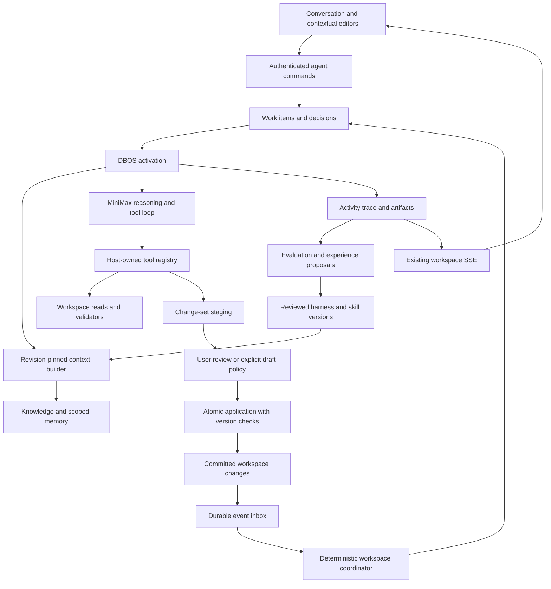

# Stack Proc ambient workspace agent harness

> Superseded runtime decision (2026-10-19): the user selected an owned source port. See [the current implementation contract](workspace-harness-port.md). Harness2 requirements below are historical and are not the active runtime direction.

Status: proposed implementation specification, 2026-10-19. MiniMax is the reasoning provider; DBOS is the durable execution substrate. The ambient harness described here is not implemented. Existing document-analysis tasks remain available during migration.

Implementation contracts: [Workspace agent harness technical specification](workspace-agent-harness-technical.md) defines schema migrations, scheduling, model/tool protocols, API payloads and code packages. It refines event-ordering assumptions and separates private provider continuation from public memory.

This specification supersedes the task-centric orchestration direction in [Workspace intelligence technical design](workspace-intelligence-technical.md). Its knowledge, revision, provenance, connection and compiler contracts remain applicable. [Implementation notes](workspace-intelligence-implementation-notes.md) describe the delivered foundation separately.

## 1. Product contract

Each workspace has a persistent intelligence capability that understands its domain and helps users develop ontologies, processes, workflows and operational agents. It observes authorized workspace changes, maintains unfinished work and decisions, retrieves relevant evidence, invokes tools, asks questions, and produces inspectable changes.

The agent is available across the application. A user can import an ontology, continue a conversation in the workflow editor, close the browser, and resume later without rebuilding the context. Its state belongs to the workspace, with explicit actor attribution and access boundaries.

The ontology describes domain meaning. Process definitions describe business behavior. Workflow graphs implement behavior through registered atomic operations. The harness reasons over all three and their execution evidence without collapsing them into one representation. Ontology concepts do not automatically become nodes; a research loop remains a composition.

Ambient means persistent awareness, resumable work and context-sensitive assistance. Model inference occurs when a work item needs reasoning. Indexing an artifact, updating dependency status, recording an event and determining whether a trigger matches are deterministic operations.

### Example

1. A user imports a banking RDF model. The import tool validates the supported structures and produces an ontology draft with application icons.
2. The user applies the import. The harness records the new revision and invalidates affected context indexes.
3. Under an enabled review policy, the agent inspects the changes, finds ambiguous Account ownership and proposes a clarification rather than guessing.
4. A user adds an account-opening procedure and asks the agent to build it. The same workspace agent reuses the ontology, reviewed decisions and available operation catalog.
5. It proposes process steps and bindings, identifies missing capabilities and produces a validated workflow draft for the supported portion only when its generation contract permits it.
6. A later failed test can become a linked investigation. The agent traces the input, assignments and operation results; any repair remains a versioned proposal.

## 2. Architecture decisions

| Decision              | Contract                                                                                                                      |
| --------------------- | ----------------------------------------------------------------------------------------------------------------------------- |
| Application ownership | The harness lives in the existing Node service and uses application Postgres. No separate agent server is required initially. |
| Durable orchestration | DBOS runs bounded work-item activations and checkpoints tool/model results. Postgres holds product-visible state.             |
| Reasoning             | A MiniMax adapter participates in a tool loop. Replaceable provider interfaces stay independent of workspace policy.          |
| Knowledge             | Existing immutable ontology, process and source revisions remain authoritative. Memory supplements them.                      |
| Event processing      | Committed domain changes feed a durable agent inbox. Browser SSE is a delivery surface, not the agent scheduler.              |
| Editing               | Tools stage changes against explicit revisions. Applying uses existing authorization, validation and optimistic concurrency.  |
| Adaptation            | Harness versions and domain skills can evolve through evaluated proposals. A running activation pins its harness version.     |
| First release         | One active mutating work item per workspace; multiple conversations and queued investigations are allowed.                    |



## 3. Current code and required changes

| Existing implementation                                        | Reuse                                                                                                       | Required extension                                                                          |
| -------------------------------------------------------------- | ----------------------------------------------------------------------------------------------------------- | ------------------------------------------------------------------------------------------- |
| `server/intelligence/service.ts`                               | Task authorization, proposal validation, knowledge acceptance and application transactions                  | Add workspace agent services; do not stretch `wi_tasks` into unrelated session/event state  |
| `server/intelligence/workflows.ts`                             | DBOS checkpoints, durable clarification waits, request reservations, cancellation and outbox reconciliation | General work-item runner with tool observations, bounded activations and resumption         |
| `server/intelligence/minimax.ts`                               | Fixed provider endpoint, credential isolation, size limits, cancellation and final-output parsing           | Tool-call response handling, argument schemas, usage accounting and model capability checks |
| `server/knowledge/store.ts` and migrations                     | Immutable revisions, evidence checks, reviews and publication                                               | Dependency index, import provenance and change-set application across artifact kinds        |
| `lib/intelligence/generation.ts`                               | Deterministic compiler path and generation manifests                                                        | Registered planner mappings; report unsupported semantics until implemented                 |
| `server/control/service.ts`                                    | Membership checks, `authorizePrincipal`, connection broker and audits                                       | Explicit agent policy grants and renewed authorization at action boundaries                 |
| `server/control/events.ts`, `cp_workspace_events`              | Persisted UI events and replay                                                                              | Agent progress event types; do not infer a reliable worker queue from the browser stream    |
| `hooks/use-workspace-events.tsx`                               | Shared SSE connection and invalidation                                                                      | Session/work-item refresh and reconnect recovery                                            |
| `components/knowledge/intelligence.tsx`                        | Existing analysis and review screens                                                                        | Agent workbench and legacy task links                                                       |
| `components/knowledge/ontology-editor.tsx` and workflow editor | Existing editing, validation and configuration surfaces                                                     | Context attachments, change previews and proposal navigation                                |

The existing source-analysis path supports a bounded task and final structured analysis, not an ambient agent. The current generator exposes linear Construct/Return generation. More advanced runtime features are not evidence of planner support.

## 4. Workspace agent identity and authority

A workspace has one logical agent configuration, many conversation sessions, and many work items. Conversations preserve intent; work items execute it. A session may discuss several artifacts, and a work item may continue after its originating browser session closes.

V1 executes under an explicitly designated workspace member and a stored policy grant. The effective permission is the intersection of current membership, grant scope, tool policy, connection scope and artifact access. The sponsor's role is rechecked before reading restricted content, resolving credentials, applying a change or starting an execution. Losing access suspends affected work. Reassignment is an explicit managed action.

A grant records who enabled it, scope, expiry, allowed triggers, allowed tools, connections, data available to MiniMax and budgets. Enabling background observation does not silently authorize sending every new document to MiniMax. Existing customer consent and connection selection remain visible.

Suggested default modes:

| Mode               | Behavior                                                                                                                                    |
| ------------------ | ------------------------------------------------------------------------------------------------------------------------------------------- |
| Disabled           | No ambient processing; existing manual editing and analysis tasks still work                                                                |
| Observe            | Index authorized changes, update dependencies and produce deterministic notices; no automatic model calls                                   |
| Assist             | Enabled triggers may start bounded reasoning and produce questions/proposals; applying changes remains explicit                             |
| Delegated drafting | A user can authorize a defined work item to update named drafts after validation; publication and live side effects remain separate actions |

V1 defaults to Observe after configuration. A user request to build a workflow creates a scoped Assist work item. These are product defaults to validate during rollout, not claims about existing permission behavior.

## 5. Lifecycle and scheduling

Agent state is `disabled`, `observing`, `active`, `waiting`, `suspended` or `attention_required`. It summarizes work; it is not a permanently running model process.

Work-item states:

```text
queued -> preparing -> reasoning <-> executing_tool
reasoning -> waiting_for_user | waiting_for_event | ready_for_review | completed
ready_for_review -> applying -> completed
applying -> conflicted
active states -> cancelled | failed | uncertain | budget_exhausted | suspended
waiting states -> queued, after a durable matching wake event
```

A work item stores purpose, scope, trigger, sponsor/grant, pinned inputs, plan, unresolved questions, pending proposals and completion criteria. A plan is revisable work state, not executable authority. Completion requires evidence against the work item's criteria, not only an agent's final message.

The coordinator claims work through a lease and fencing token. V1 permits one active writer per workspace; reads and indexing may proceed concurrently. An expired lease permits recovery but does not authorize repeating an external call. Later concurrency can partition by artifact only after conflict and recovery tests exist.

Default proposed budgets per activation: 12 reasoning turns, 24 tool invocations, 2 concurrent read tools, 120 seconds per model request, 5 minutes active wall time, and a configurable token/currency ceiling. The first reached limit checkpoints state and yields. Lifetime budgets also apply, so repeated resumptions cannot bypass a cap. No automatic infinite continuation on budget exhaustion.

Questions and reviews create durable waits, not occupied HTTP requests or continuously billed reasoning. A scheduled reevaluation has an explicit due time and trigger policy. Cancel prevents new calls and marks in-flight outcomes separately; it does not pretend an issued external request was rolled back.

## 6. Events and ambient behavior

V1 event inputs are source import/revision, ontology revision/review/publication, process revision, workflow save/test completion, connection change/revocation, user message/decision and explicit scheduled reevaluation. Execution progress ticks are coalesced; browsing, focus changes and individual keystrokes do not trigger reasoning.

An event contains workspace, stable event ID, type, affected references, actor, origin work item, correlation/causation IDs and commit time. It contains identifiers and bounded metadata rather than credentials or full source documents.

Committed domain mutations enqueue agent events in the same transaction as the artifact change. An outbox dispatcher creates inbox work with a unique `(workspace_id, event_id)` key and records delivery. Notifications and Postgres LISTEN wake the dispatcher; persisted outbox rows remain authoritative after outages. Existing event producers need explicit adapters until their mutations emit the new domain outbox.

Do not advance a numeric high-water cursor and assume all lower sequence IDs committed first. The inbox/outbox protocol acknowledges individual committed events and reconciles undelivered rows. SSE reconnects cannot schedule duplicate agent work.

Trigger rules deterministically select eligible events, scope and budget. Related changes are debounced into a context invalidation batch, while user decisions, access revocations and explicit cancellation are handled immediately. Each batch retains original event IDs. Agent-generated changes carry origin IDs so a work item cannot trigger itself indefinitely. A later independent change may legitimately reopen analysis.

## 7. Context assembly

Every activation creates a context manifest:

- Workspace/grant and actor scope, harness/tool/model versions and trigger policy.
- User goal and relevant conversation segment, unresolved questions and plan state.
- Exact source, ontology, process and workflow revision references plus hashes.
- Relevant authorized run IDs, selected execution evidence and operation definitions.
- Accepted workspace decisions, applicable domain skills and candidate memories with trust labels.
- Retrieval queries, selected excerpts, omitted material and context budget.

Content is retrieved on demand with workspace-first filtering. Start with relational metadata, names, stable IDs, source blocks and Postgres text search. Embeddings are optional later; correctness and access control cannot depend on vector similarity. Search results always resolve to permission-checked source revisions.

Knowledge and tools are discoverable resources. The initial prompt carries a compact index and task context rather than every document. Large observations have summaries plus durable paginated references. Compaction records an index and task summary while retaining original messages, tool observations and evidence; summaries never replace source facts.

Unsaved editor drafts enter context only when the user explicitly attaches the current draft. The attachment has its own snapshot hash and editor version. Suggestions against it return to that editor; they do not silently replace the saved head. A changed local draft makes application stale.

## 8. Memory and domain adaptation

| Memory                      | Contents                                                           | Authority and lifetime                                  |
| --------------------------- | ------------------------------------------------------------------ | ------------------------------------------------------- |
| Working state               | Goal, plan, tool results, questions and draft proposals            | Work-item scoped; retained through resumptions          |
| Episodic experience         | What was attempted, outcome, validation evidence and user feedback | Workspace scoped; retrievable with provenance           |
| Domain knowledge            | Entities, relationships, processes and meanings                    | Existing versioned knowledge artifacts                  |
| Accepted decisions          | Terminology, mappings, user choices and preferences                | Explicit decision record with scope and supersession    |
| Skills and harness settings | Reusable procedures, retrieval guidance and tool-use conventions   | Versioned packages with evaluation and adoption records |

Memory records include source references, author/origin, proposed/accepted/rejected/stale status, applicability, dependencies, expiry and supersession. A model's confident statement does not become an accepted fact. Contradictory or stale evidence creates a review item; a new summary cannot overwrite a reviewed decision.

A tenant's experience is not automatically shared with another tenant. Global reusable skills are product-controlled packages; promoting a domain lesson across workspaces requires a separate explicit process. A service restart preserves memory and unfinished work without requiring model retraining.

## 9. Tool protocol and catalog

Tools are host-owned, versioned definitions. Each declares input/output schemas, permission, effect class, connection requirements, idempotency behavior, limits, observation policy and supported evidence. Model-provided names must resolve to the registry. Invalid arguments produce a structured observation that the agent can repair within budget.

```ts
type AgentToolCall = {
  id: string;
  workItemId: string;
  turnId: string;
  tool: string;
  version: number;
  arguments: unknown;
  expectedRefs: { id: string; revision: string; hash: string }[];
  idempotencyKey: string; // Issued by the host, not accepted as model authority.
};

type AgentObservation = {
  callId: string;
  status: 'completed' | 'invalid' | 'denied' | 'failed' | 'uncertain';
  resultRef?: string;
  summary: string;
  evidenceRefs: string[];
  error?: { code: string; retryable: boolean; fields?: string[] };
};
```

Initial catalog:

| Tools                                                                              | Contract                                                             |
| ---------------------------------------------------------------------------------- | -------------------------------------------------------------------- |
| `workspace.describe`, `workspace.search`, `artifact.read`, `source.read_blocks`    | Authorized resource discovery and paginated reads                    |
| `ontology.import_rdf`, `ontology.validate`, `ontology.inspect`, `ontology.compare` | Parse supported RDF, validate/project and inspect differences        |
| `ontology.propose_changes`, `process.propose_changes`, `workflow.propose_changes`  | Stage typed proposals; preserve stable references                    |
| `capability.search`, `connection.describe`                                         | Discover registered operations and non-secret connection metadata    |
| `process.validate`, `workflow.compile`                                             | Deterministic validation and supported generation mappings           |
| `workflow.inspect_run`, `workflow.trace_value`                                     | Read authorized execution evidence and explicit assignments          |
| `changes.preview`, `changes.apply`                                                 | Show differences; apply under policy and version checks              |
| `agent.ask_user`, `agent.record_memory`, `agent.complete`                          | Persist questions, candidate memories and evidence-backed completion |

Test execution is a separately granted tool because a test can invoke real services. V1 probes use isolated fixtures by default. Connection creation, publication, live runs, external messages and unrestricted command execution are not incidental powers of a drafting tool. Existing code-node runtimes stay behind their explicit capability profiles.

A tool may perform a business-level transaction involving several artifacts; that does not redefine atomic canvas operations. Agent orchestration is visible in its activity trace rather than hidden inside a synthetic domain node.

## 10. MiniMax reasoning adapter

Introduce `AgentModelAdapter` alongside the existing final-analysis adapter. Inputs are conversation/tool observations, available tool schemas, selected model, budget and cancellation signal. Outputs are normalized assistant text, tool calls, completion state and usage metadata. Provider-specific wire formats stay in the adapter.

The dispatcher validates tool names and arguments, authorizes execution, records the call, invokes the tool and sends its bounded observation into the next turn. Parallelism is allowed only for independent read tools. Mutations execute serially against declared versions. Model intent does not directly access the database, connections or arbitrary HTTP endpoints.

Resolve the selected workspace MiniMax connection through the existing credential broker. Pin its revision at work-item creation and revalidate before each issued call. Credentials remain server-side. Retain final messages, tool requests/results and concise decision explanations; private reasoning fields are not workspace memory or UI output.

Before enabling a model, contract tests and a small authorized provider test must verify tool calling, argument handling, usage fields, cancellation and incomplete responses for that model. The current structured-analysis adapter alone does not prove these capabilities. Unsupported tool calling is an explicit capability error, not a silent fallback to an unrelated JSON endpoint.

## 11. Durability and uncertain outcomes

Create work items and their start commands transactionally. Register DBOS workflows before `DBOS.launch`, reconcile start/wake outbox records on startup, and use deterministic workflow IDs containing workspace, work item and activation number.

Persist a turn's input manifest and call reservation before issuing a model request. Record the normalized response and usage before advancing. A completed call is reused after recovery. A reserved call whose response was never recorded becomes `uncertain`; the existing no-blind-retry contract remains. Provider reconciliation may resolve it if supported; otherwise expose an explicit retry decision with the possible duplicate charge recorded.

Tool calls use `prepared -> running -> completed/failed/uncertain` records. In-database edits and their call completion commit together where possible. External mutations require provider idempotency keys or a reconciliation function. A DBOS checkpoint alone cannot guarantee exactly-once effects in an unrelated external system.

Each activation pins harness, tool and compiler versions. Recovery uses compatible registered versions or enters an actionable migration state. Fresh context after an external change is a new turn; it does not rewrite already checkpointed observations.

## 12. Change proposals and application

A change set records its goal, base revisions, proposed after-state, stable-ID differences, rationale, evidence, validation results and affected dependents. It can include multiple ontology/process/workflow changes with internal temporary references resolved during application. V1 stores typed before/after artifacts rather than allowing arbitrary database patches.

Applying performs a single workspace-scoped transaction:

1. Reauthorize actor and grant; validate operation, connection and artifact scopes.
2. Lock affected heads in stable ID order and compare expected edit versions/hashes.
3. Validate each proposed artifact and cross-artifact references; compile executable graphs.
4. Create immutable revisions and any generation manifests, application receipts and decision records.
5. Insert domain events and audit records, then commit.

A unique application key makes repeated Apply return the existing receipt. A stale base yields a conflict with a comparison; it cannot overwrite another user's changes. Rebase creates a new proposal and invalidates prior approval for changed content. Declining a proposal preserves the draft and records the scoped feedback.

Generated drafts retain unresolved capability requirements. A valid-looking graph containing simulated success is not a substitute for an unavailable integration. Publication remains the existing managed lifecycle, and existing workflows remain pinned to their accepted ontology revisions.

## 13. RDF import and entity presentation

RDF import is a deterministic harness tool and a manual designer command using the same application service. It does not require a model connection. V1 accepts RDF/XML through file selection or pasted text, with a 1 MiB input limit and existing entity/property/relationship limits. Turtle and JSON-LD are later format adapters and must be identified as unsupported in V1.

The importer retains the original source bytes/text, hash, format, source identifiers and supported RDF metadata as import provenance. Entity identity is derived from preserved source IRIs through a stable mapping; display labels are not identity. Imported property identifiers must remain stable across reimports. Named-node collisions and mapping changes produce explicit conflicts.

The preview reports entity/property/relationship counts, supported mappings, unresolved references, dropped/unsupported constructs and whether the action creates a new module, replaces a draft or proposes an update. Empty or malformed models cannot silently clear the workspace. DTD/entity declarations are rejected; external `owl:imports` are recorded without fetching. Supported SHACL metadata is retained without claiming a complete SHACL/OWL evaluator.

The existing Microsoft parser/projection is a starting point, not evidence of lossless arbitrary RDF support. Unsupported semantics retain the original source and block affected automated generation until resolved. Merge/reimport is delivered after replace/create preview; matching labels alone cannot merge concepts.

Entity presentation uses a controlled catalog of Font Awesome Pro glyph identifiers and Material palette accents. Known imports retain valid deliberate icon choices; missing/generic/unsupported choices receive a deterministic domain-aware suggestion. Unknown concepts use the standard entity glyph. MiniMax may later suggest a catalog choice through a proposal; it never supplies executable SVG or unregistered assets. Users can override icons without changing semantic IDs. Provenance records whether an icon was imported, inferred or chosen by a user, so reimport does not overwrite manual choices.

The visual editor applies an import as one undoable draft replacement. Saving persists a revision; publication is separate. The ambient agent receives an event after the source/import change is committed, not on each preview edit.

## 14. Harness versions and Harness² adaptation

Reference inspected at Harness² commit `1cfe254e8d25b15f37048c3730134686abe60335`, Apache-2.0. Its [core recursion](https://github.com/google-research/harness2/blob/1cfe254e8d25b15f37048c3730134686abe60335/harness2/core/recursion.py) explores candidate harnesses; its [context](https://github.com/google-research/harness2/blob/1cfe254e8d25b15f37048c3730134686abe60335/harness2/core/context.py) and [experience library](https://github.com/google-research/harness2/blob/1cfe254e8d25b15f37048c3730134686abe60335/harness2/core/library.py) make execution evidence and adopted experience available to later tasks. Its [substrate interface](https://github.com/google-research/harness2/blob/1cfe254e8d25b15f37048c3730134686abe60335/harness2/substrate/base.py) separates those concerns from agent execution.

**Required architecture, superseding the earlier reference-only decision:** Stack Proc must import and execute the actual pinned Harness2 engine. Harness refinement, selection and experience-library behavior must come from upstream. Harness2 delegates task execution to a substrate: use its supported OpenCode executor with MiniMax, connected through workspace-scoped host adapters. DBOS remains the durable scheduling and application persistence layer. The existing custom MiniMax model/tool loop is legacy migration code, not an acceptable target architecture or fallback. See [Harness2 cutover](harness2-cutover.md) for the boundaries and completion gates. The dependency check does not establish production cutover.

A harness package contains a manifest, system/context guidance, domain skill versions, retrieval strategy, tool guidance, memory rules, delegation settings, budgets and evaluation references. Tool implementations, application authorization and credential policies remain host-controlled. Packages have immutable versions, hashes, applicability and adoption records.

The improvement loop is:

1. Select a concrete authoring task and its baseline traces, outcomes and user feedback.
2. Propose a bounded harness/skill change with a stated hypothesis.
3. Probe baseline and candidate against the same isolated fixture and pinned capability set.
4. Compare artifact validity, task criteria, execution behavior, provenance, cost and regressions.
5. Compose a candidate using supported evidence; propose a scoped lesson or package revision.
6. Adopt a validated version under its configured review policy; preserve rollback and evaluation results.

Start with one sequential candidate and a fixed budget. Wider parallel search is a later measured optimization. Self-evaluation alone is insufficient to establish correctness; deterministic contracts and held-out domain fixtures must gate adoption. Tenant permissions and publication policy are outside the editable improvement surface.

## 15. Persistence additions

Use a new checksum-tracked migration; do not modify checksums of already applied migrations. All product records carry `workspace_id`, composite foreign keys and indexes for their workspace queries.

| Proposed table                          | Primary purpose and constraints                                                                                                       |
| --------------------------------------- | ------------------------------------------------------------------------------------------------------------------------------------- |
| `wa_agents`                             | Workspace configuration, sponsor/grant reference, enabled state, model connection and policy version; one configuration per workspace |
| `wa_grants`                             | Actor-approved scope, tool/connection/data limits, trigger rules, budgets, expiry/revocation and revision                             |
| `wa_sessions`, `wa_messages`            | Conversation identity and ordered append-only messages with unique client message IDs                                                 |
| `wa_work_items`, `wa_activations`       | Goal/state, causal source, pinned configuration, lease/fence, budgets, parent/resume relationships and DBOS workflow ID               |
| `wa_domain_outbox`, `wa_inbox`          | Transactional mutation events, individual delivery receipts, deduplication and trigger/coalescing state                               |
| `wa_context_manifests`                  | Revision-pinned retrieval and attachment manifests and context hashes                                                                 |
| `wa_turns`, `wa_model_calls`            | Turn input/output references, call reservation, normalized result, usage and uncertainty                                              |
| `wa_tool_calls`, `wa_observations`      | Versioned invocation, effect/idempotency metadata, observations and reconciliation state                                              |
| `wa_change_sets`, `wa_applications`     | Proposed before/after artifacts, expected versions, review decisions and unique application receipts                                  |
| `wa_decisions`, `wa_memories`           | Scoped user decisions and candidate/accepted/stale experiences with provenance                                                        |
| `wa_harness_versions`, `wa_evaluations` | Immutable package metadata, baseline/candidate evidence and adoption history                                                          |
| `wi_imports`, `wi_import_identity_map`  | Original RDF provenance and stable IRI-to-artifact/element mappings for repeatable import                                             |

Store large source/observation payloads through an artifact reference abstraction; V1 can use bounded application-database records. Define retention and redaction before enabling run-payload retrieval. No secrets, raw private reasoning or cross-workspace corpus in memory tables. Historical records remain accessible only through current permission checks.

## 16. Application API and event surface

Add `/api/agent/*` to the existing Node HTTP routing. Keep `/api/intelligence/tasks` for legacy tasks during transition. Reads require `read`, ordinary drafting commands require `execute`, and workspace-wide agent grants/configuration require `manage`. Every endpoint validates workspace context and optimistic versions where applicable.

| Endpoint                                   | Purpose                                                                            |
| ------------------------------------------ | ---------------------------------------------------------------------------------- |
| `GET /api/agent/state`                     | Effective agent state, capabilities, policy and pending attention                  |
| `PUT /api/agent/configuration`             | Configure grant, triggers, MiniMax connection and budgets                          |
| `GET/POST /api/agent/sessions`             | List/create sessions                                                               |
| `GET /api/agent/sessions/:id`              | Session, linked work items and paginated conversation                              |
| `POST /api/agent/sessions/:id/messages`    | Idempotent user message plus optional revision/draft attachments; return 202       |
| `GET /api/agent/work-items/:id`            | Goal, current state, plan, activity, questions and proposals                       |
| `POST /api/agent/work-items/:id/decisions` | Answer/review/retry decision and durable wake event                                |
| `POST /api/agent/work-items/:id/cancel`    | Persist cancellation and signal active execution                                   |
| `GET /api/agent/change-sets/:id`           | Differences, provenance, validation and dependency impact                          |
| `POST /api/agent/change-sets/:id/apply`    | Version-checked, idempotent application under effective policy                     |
| `POST /api/knowledge/imports/rdf/preview`  | Persist bounded source/import provenance and return a non-applied parsed candidate |
| `POST /api/knowledge/imports/:id/apply`    | Apply the reviewed import to a named new/existing draft                            |

The shared workspace event stream gains `agent.work_queued`, `agent.activity`, `agent.question`, `agent.proposal_ready`, `agent.conflicted`, `agent.completed`, `agent.uncertain` and `agent.budget_exhausted`. Event payloads contain references and safe summaries. After reconnect, clients fetch authoritative state. The notification bell shows actionable questions/failures/proposals; routine tool progress stays in the activity view.

## 17. User interface

The workspace agent workbench has conversation, current goal/plan and linked artifacts/activity. Chat is an interaction surface; generated models remain first-class editable artifacts. Sessions can be resumed and linked to work items independently of the current page.

Ontology and workflow editors expose an Agent entry point with their current saved reference and an explicit Attach current draft action. Agent proposals open in a comparison view with field/node-level changes and evidence links. Applying a proposal never silently takes over an editor that has diverged locally.

The agent indicates what it is doing, what is waiting, which input revisions it used and how to stop or continue. Show concise rationales and tool results rather than private reasoning. Users can inspect where a value was initialized, changed and consumed in a run.

Administrative agent configuration and work-item lists follow the existing Stack Proc work-area skill: contextual header, aligned actions/filters, tabs below, bounded scrolling and icon table actions. Fullscreen ontology/workflow canvases retain their separate layouts. Untitled UI components, application typography and square controls remain the shared visual contract.

## 18. Reference implementation structure

```text
lib/agent/
  contracts.ts          # states, messages, manifests, calls, observations, proposals
  policy.ts             # effective scope and deterministic trigger decisions
  tools.ts              # shared versioned tool schemas and effect classes
  context.ts            # retrieval selection and context manifests
  memory.ts             # trust, dependency and applicability rules
  changes.ts            # typed differences and validation contracts
server/agent/
  store.ts              # workspace-scoped persistence and migrations
  service.ts            # authenticated product commands
  coordinator.ts        # outbox/inbox, coalescing, leases and work scheduling
  workflows.ts          # DBOS activation, wait and recovery protocol
  models/minimax.ts     # normalized MiniMax tool-loop adapter
  tools/                # registered handlers reusing knowledge/compiler services
  evaluation/           # fixtures, trace comparison, package adoption
  routes.ts             # /api/agent/*
components/agent/
  workbench.tsx         # conversation and linked work
  activity.tsx          # visible tool activity and evidence
  change-review.tsx     # revision-aware proposed changes
hooks/use-agent.ts      # state loading and existing SSE invalidation
```

`server/index.ts` initializes the agent store after control/knowledge, registers its DBOS workflows before launch and reconciles persisted work on startup. Existing source analysis can be wrapped as a tool-backed work item after the compatibility slice; do not create two independent mutation authorities.

### Legacy task and evidence compatibility

Keep existing `wi_tasks`, model-call reservations and generated manifests readable; do not reinterpret their IDs as new agent work items. A linking record can associate a legacy analysis with a session/work item, while its original history and provenance stay intact. New authoring uses one change-application service; compatibility wrappers call that service rather than applying a second time.

The current evidence union refers to source blocks, user decisions and task inferences. Add a versioned agent-inference variant containing a work-item ID, observation/decision reference and explanation, with server-side workspace checks. Do not fabricate a `wi_tasks` row or valid-looking legacy task ID to satisfy the old schema. Persisted old evidence remains valid. Generation manifests likewise gain optional session/work-item, change-set, harness and tool-version references while retaining legacy provenance.

New schema/tool contracts require migrations and compatibility tests before enabling the runtime. The delivery status remains proposed until the corresponding code and recovery tests pass.

## 19. Delivery sequence

| Increment                            | Deliverable                                                                                                     | Exit criterion                                                                                                     |
| ------------------------------------ | --------------------------------------------------------------------------------------------------------------- | ------------------------------------------------------------------------------------------------------------------ |
| 1. Harness contracts and persistence | Agent configuration, grants, sessions, work items, event inbox/outbox and activity records                      | A session/work item survives restart, events deduplicate and revoked grants suspend work; no model needed          |
| 2. Deterministic workspace tools     | Discovery, retrieval, ontology validation, RDF preview/import with stable identities, change staging and review | Manual commands and fixture agents use the same tools; Apply/Undo/CAS/provenance work                              |
| 3. MiniMax agent loop                | Tool-calling adapter, DBOS activations, durable questions, cancellation and budgets                             | Agent completes an ontology task through multiple tools and resumes after restart without reissuing recorded calls |
| 4. Ambient coordination and memory   | Enabled event triggers, context invalidation, decisions and scoped experience retrieval                         | Import/revision/test events produce one relevant work item and retain accepted decisions across sessions           |
| 5. Process/workflow authoring        | Capability discovery, reviewed process mapping, compiler feedback and existing generation manifests             | A supported multi-artifact fixture creates a valid editable workflow; unsupported capabilities remain explicit     |
| 6. Harness evaluation and adaptation | Baselines, candidate probes, domain experience and version adoption/rollback                                    | A measured improvement passes held-out domain and recovery fixtures before adoption                                |

RDF UI can ship with increment 2 independently of MiniMax. Increment 1 is the intelligence starting point. No “AI refine” HTTP endpoint is presented as completion of the harness.

## 20. Acceptance scenarios

1. **Persistence:** begin a conversation, create an unfinished work item, restart service and browser, then resume with original goal, references and decisions.
2. **Ambient deduplication:** deliver the same committed import event repeatedly, including after a dispatcher crash; one work item is created. Out-of-order commits are not skipped.
3. **Authority:** revoke sponsor membership or connection access during a wait; resumption cannot read restricted context, resolve a key or apply changes.
4. **Model recovery:** crash after a call reservation and after a completed response. Completed responses replay; uncertain outcomes require a recorded resolution rather than a blind retry.
5. **Tools:** reject unknown tools, invalid arguments and denied effects; return actionable observations without invoking handlers.
6. **Context:** use a pinned ontology revision while its head changes. The resulting proposal identifies staleness and cannot overwrite the new head.
7. **Draft attachment:** attach unsaved editor content, edit it again, then attempt Apply. The old proposal cannot replace the newer local draft.
8. **RDF:** import a small RDF/XML model, preserve source IRIs and relationships, assign application glyphs, preview before application and undo once. Reimport retains IDs and user icon overrides. Unsupported constructs are reported; oversized, DTD and malformed input fail without mutation.
9. **Domain continuity:** clarify Account ownership in one session; a later process-building session retrieves the accepted scoped decision and its evidence.
10. **Capability honesty:** request a process requiring an unavailable integration. The agent reports that requirement and cannot manufacture a successful executable action.
11. **Atomic application:** concurrently edit one artifact in a proposed multi-artifact change. No partial revisions or workflow writes are committed on conflict; repeated valid Apply returns its receipt.
12. **Feedback loops:** an agent-applied draft event cannot recursively requeue its own completed work without an independent trigger or user request.
13. **Budget and cancellation:** hit a limit or cancel during a tool/model call; state remains resumable and no new call starts afterward.
14. **Isolation:** identical terms in two customers' workspaces do not share documents, credentials, decisions or experience.
15. **Improvement:** compare baseline and candidate with fixed inputs and fixture tools; reject a candidate that improves one example while breaking held-out compilation or evidence rules.
16. **UI:** reconnect SSE and recover activity/questions, navigate to evidence, review differences and retain the existing editor draft without page-level scroll or inaccessible controls.

## 21. Open design choices

The proposed defaults above allow contracts and deterministic tools to begin without deciding every deployment detail. Before enabling delegated production behavior, confirm grant UX and renewal, data retention/redaction, currency budget attribution, domain-skill adoption ownership, and whether service principals replace member sponsorship for enterprise workspaces.

Initial retrieval is relational/text based; embedding provider selection is deferred. MiniMax tool-call wire behavior and selected model support must be verified in increment 3. Expanded RDF formats, automatic cross-module merge, arbitrary OWL reasoning, parallel mutating agents and production self-modifying harnesses remain separate increments.
