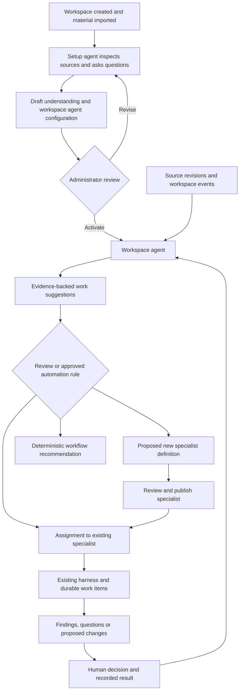

# Workspace agent setup and specialist coordination

Status: core lifecycle implemented locally, 2026-10-20. See the implementation record below for delivered boundaries and remaining rollout work. No existing workspace has been automatically activated.

Implementation contracts are defined in the [technical specification](workspace-agent-lifecycle-technical.md).

## Product decision

A workspace acquires a purpose and operating context through setup. A setup agent examines the supplied ontology, process documents and other material, asks about goals and responsibilities, and proposes a workspace agent configuration. An administrator reviews and activates that configuration. The workspace agent then maintains its understanding, identifies useful work and recommends bounded assignments to specialist agents.

All of these agents run on the existing Stack Proc harness and DBOS execution host. An agent definition supplies identity, instructions, context and permitted capabilities. An assignment supplies a particular goal, inputs, limits and completion criteria. A session retains interaction history. A work item records a durable execution. These are separate records with separate lifecycles.

The experience centers on activities, decisions and results. An agent is not a conversation, and creating a new session does not create an agent. A suggested assignment does not require a new specialist when an existing specialist or deterministic workflow is suitable.

Do not build custom replacements for the library's Agent List, Agent Create or Agent Summary. Reuse their licensed presentation components when the corresponding product slice is authorized. Host composition, persistence adapters and authorization remain application responsibilities.

## Current implementation and gaps

| Area                     | Current source and behavior                                                                                                                                  | Required extension                                                                                                |
| ------------------------ | ------------------------------------------------------------------------------------------------------------------------------------------------------------ | ----------------------------------------------------------------------------------------------------------------- |
| Workspace configuration  | `server/agent/service.ts` reads one `wa_agents` row keyed by workspace; `lib/agent/contracts.ts` defines enablement, MiniMax connection, runtime and limits  | Keep this as the workspace policy ceiling; introduce reusable agent identities and revisions separately           |
| Execution                | `server/workspace-harness/query.ts` owns lifecycle; `server/agent/workspace-runtime.ts` owns DBOS checkpoints, authorization, model/tool receipts and leases | Resolve a pinned agent revision into this host; no additional agent execution loop                                |
| Intake                   | `server/agent/intake.ts` queues goals and answers with policy revision and actor attribution                                                                 | Resolve agent identity and revision transactionally at intake, record them on requests and work                   |
| Specialists              | `server/agent/tasks.ts` creates bounded read-only child work from goals                                                                                      | Add references to published specialist definitions and assignment receipts; retain existing read-only constraints |
| Process agent activities | `lib/processes/agent.ts` and `server/agent/process-activity.ts` use inline goals, output schemas and a narrow read-only tool list                            | Add an explicit versioned binding to a published agent revision without expanding process authority               |
| Ambient work             | Workspace events and `server/agent/schedules.ts` enqueue harness work under an authorized actor                                                              | Route eligible events to configured agents, with deduplication, bounded review and recorded provenance            |
| Knowledge                | Immutable knowledge revisions, evidence, RDF import and paginated artifact reading exist                                                                     | Add a persistent, evidence-backed workspace understanding and coverage record                                     |
| Presentation             | `components/intelligence/workspace.tsx` composes licensed activity, session, context, question and review components                                         | Add agent-aware projections and navigation, preserving the existing activity inspection surface                   |

The existing `wa_agents` table name does not establish a multi-agent registry: its primary key permits one configuration per workspace. The current delegate tool does not select reusable named specialist definitions. The component catalog does not supply these backend capabilities.

## Lifecycle

### Workspace setup

1. An owner or administrator starts setup after importing material, or starts with no files and supplies goals manually. File presence is optional; setup completeness must not be fabricated.
2. The platform selects a versioned setup-agent template and records a workspace-scoped setup run. It can read authorized material, ask structured questions and propose configuration. It cannot grant itself access, publish agents, apply domain changes or execute business workflows.
3. Source inspection builds an inventory of imported revisions, domain concepts, processes, participants, candidate responsibilities and missing capabilities. Large ontologies use entity indexes, individual entity views, literal search and revision-pinned continuations. Budgets stop inspection with explicit coverage gaps, rather than substituting remembered vocabulary definitions.
4. The agent uses `ask_user_v2` for unresolved purpose, priorities, ownership and operating boundaries. Questions persist and resume through the existing typed interaction path.
5. Setup produces two reviewable drafts: the workspace understanding and the workspace agent definition. It may also propose specialist roles, but does not instantiate or activate them.
6. Review presents purpose, evidence, unresolved matters, requested tools and context, model connection, budgets and trigger behavior. An administrator can edit, reject or activate. Activation commits the approved understanding reference, published agent revision and coordinator pointer in one transaction.

Setup states are `collecting`, `inspecting`, `waiting_for_user`, `ready_for_review`, `activated`, `cancelled` and `failed`. Execution underneath uses existing work states. Setup can complete with explicit gaps if the administrator accepts them. A prerequisite such as missing model consent remains a blocker, not an accepted knowledge gap.

The setup agent can return later in a reconfiguration run. It proposes a new coordinator revision against the current version; it does not overwrite the active coordinator or reopen initial setup on every import.

### Workspace understanding

Store structured, revisioned knowledge about the workspace, rather than one opaque system prompt:

| Section      | Required content                                                                                    |
| ------------ | --------------------------------------------------------------------------------------------------- |
| Purpose      | User-confirmed goals, priorities, exclusions and success criteria                                   |
| Domain       | Ontology references, important concepts and terminology                                             |
| Processes    | Imported or authored process references, participants and responsibilities                          |
| Capabilities | Discovered executable operations, published tools and unavailable requirements                      |
| Evidence     | Artifact/revision IDs, stable entity IDs or source-block references                                 |
| Coverage     | Per-source revision inspection ranges or entities inspected, remaining coverage and parser warnings |
| Decisions    | Accepted user answers, reviewer identity and decision references                                    |
| Uncertainty  | Conflicts, hypotheses, unanswered questions and stale assertions                                    |

Each assertion records its evidence and whether it is source-derived, user-confirmed or an unaccepted hypothesis. A generated interpretation never silently becomes a business fact. Source updates invalidate dependent assertions and suggestions; they do not erase the previous understanding revision. Access removal makes affected assertions unavailable to an execution even if their evidence was formerly readable.

The coordinator retrieves relevant portions within its context budget. The understanding is neither an assertion that all imported material was read nor a promise that every source has a searchable index. Existing text/Markdown upload limits and supported RDF/process import formats remain in force; unsupported document formats become explicit ingestion gaps.

### Ongoing coordination

The coordinator responds to user instructions, configured source/process changes, failures and approved schedules. It compares current evidence with accepted goals and produces suggestions such as:

- Inspect ontology classes whose imported properties were not fully projected.
- Resolve a process activity that has no executable capability binding.
- Investigate repeated failures in a published workflow.
- Ask a process owner to clarify an approval responsibility.

A suggestion includes a concrete goal, why it matters, evidence, proposed executor, expected output, required context/tools, estimated limits and review requirements. Estimates must be labeled; missing cost measurements remain unknown.

Suggestions progress through `proposed`, `accepted`, `dismissed`, `superseded` or `withdrawn`. Execution state belongs to the linked assignment and work item. Repeated events use a stable finding key based on agent, rule, subject and relevant source revisions, so one issue does not produce an endless queue of identical recommendations. Dismissal persists a reason and suppresses equivalent suggestions until relevant evidence changes or the user explicitly revisits it.

Initial delivery requires explicit acceptance before dispatch. Later automation rules may authorize bounded read-only assignments to specified published specialists. They cannot create/publish agents, widen permissions, apply domain proposals or enable external writes. Cap coordinator runs, suggestions per activation, outstanding assignments, delegation depth and aggregate model/tool consumption. No recursive self-assignment or unbounded agent creation.

### Specialist agents and assignments

A specialist definition is reusable across assignments in its workspace: for example, an ontology reviewer, process analyst or execution investigator. Each assignment pins the specialist revision, goal, context revisions, input/output contract, parent suggestion, accountable actor, limits and completion criteria.

The coordinator recommends a new specialist only when existing agents or deterministic capabilities do not fit a recurring responsibility. Agent creation itself is reviewed configuration work. It must not be disguised as ordinary delegation.

A completed assignment returns structured findings, evidence and any existing change-set references. Completion does not mean the proposed changes were applied. Failed, cancelled, uncertain, suspended and budget-exhausted work retain those states. The coordinator can propose a follow-up, but may not automatically repeat an uncertain external effect.

## Agent identity and version contracts

Introduce workspace-scoped identities with kinds `setup`, `coordinator` and `specialist`. A setup template has platform-controlled provenance; its workspace execution is still tenant-scoped. A workspace has at most one active coordinator pointer, and may have many published specialists.

An editable draft contains name, description, instructions, purpose, context bindings, declared tools and permissions, approved skill references, MiniMax connection revision, limits, input/output schemas and trigger bindings. Partial model-generated drafts are provisional, schema-validated and non-executable.

Published revisions are immutable and content-hashed. Identity metadata tracks draft edit version, published revision, operational enablement, ownership and archive state. Draft/live/paused describes configuration availability; running/waiting/failed describes a particular work item. A failed run does not unpublish an agent. Editing a draft does not alter running work.

Publishing validates schemas, tool and connection references, data access and policy compliance. Every request records the exact agent revision and effective policy snapshot before queueing. Resume uses the same revision; a later publication never substitutes new instructions or tools. Current permission revocations and the workspace model kill switch still apply before each model/tool call and at review/application time. Policy expansion cannot enlarge an already queued assignment.

Rename is identity metadata, with audit history; name-at-run remains in execution provenance. Publish changes executable content. Pause blocks new runs and suspends queued/active work at the next safe checkpoint; issued calls drain and their receipts remain authoritative. Resume requires an explicit action and current authorization. Archive blocks new assignments and preserves history. Only unused drafts may be deleted; referenced agents are archived.

## Authority and knowledge isolation

Effective permission is the intersection of current workspace policy, the published agent revision, the assignment restriction and the invoking actor's current authority. Agents are not user accounts. An agent owner or sponsor does not confer that person's permissions on every caller.

| Role        | Agent configuration                                                                  | Assignment and review                                                                                      |
| ----------- | ------------------------------------------------------------------------------------ | ---------------------------------------------------------------------------------------------------------- |
| Owner/admin | Create/edit drafts, publish, activate coordinator, configure triggers, pause/archive | Invoke, assign and review subject to existing domain permissions                                           |
| Editor      | Create/edit specialist drafts within workspace policy; propose coordinator revisions | Invoke permitted published agents, accept read-only assignments and review domain changes where authorized |
| Viewer      | Inspect permitted definitions and activity                                           | No invocation, upload, assignment or modification approval                                                 |

Owners/admins/editors retain context-upload defaults, subject to the existing workspace editor-upload permission. Publishing specialist drafts remains administrative in the first release. Tool approval cannot override a denied tool, bypass a domain review gate or grant a credential scope.

Enforce resource scope in `workspace_describe_v1`, `artifact_read_v1`, evidence resolution, result reads and memory searches, not merely in attachment UI. Read results must not disclose artifacts outside the effective scope. Newly authored agents default to selected context rather than implicit workspace-wide access. The coordinator's broader inventory scope is shown and approved during setup. Existing whole-workspace memory must not silently become visible to every specialist: new memories carry explicit workspace or agent scope, with session/assignment scope for transient context. Legacy accepted memory remains available to the legacy default path until explicitly classified.

Schedules and ambient assignments record the accountable principal and reauthorize at dispatch; source text and event payloads cannot select a privileged actor. Until a separate service-principal contract exists, retain the current authorized sponsor model and suspend automation if that principal loses permission. Agent creation does not implement Azure/AWS execution identities.

## Library component composition

The catalog inventory and the authenticated previews/source contracts for Agent List, Agent Create and Agent Summary were reviewed. Their callbacks permit host-managed state. These three sources are not currently imported under `vendor/aisdkagents`; importing them is future implementation work. Supporting configuration components below are catalog candidates whose complete source adaptation must be reviewed before use. Existing imported sources and original hashes remain in `vendor/aisdkagents/provenance.json`.

| Product responsibility       | Library component                                                                                                                                        | Stack Proc adapter and restrictions                                                                                                                                                                   |
| ---------------------------- | -------------------------------------------------------------------------------------------------------------------------------------------------------- | ----------------------------------------------------------------------------------------------------------------------------------------------------------------------------------------------------- |
| Workspace-owned registry     | [Agent List](https://www.aisdkagents.com/ai-components/agent-list)                                                                                       | Project real definitions and latest work state; server-backed search/paging. Wire open/create/pause/duplicate only when authorized; omit delete for referenced agents                                 |
| Guided specialist draft      | [Agent Create](https://www.aisdkagents.com/ai-components/agent-create)                                                                                   | Route draft generation through the same harness and a validated draft output contract. Stop cancels that generation work; opening a draft never publishes it. Manual draft creation remains available |
| Agent overview               | [Agent Summary](https://www.aisdkagents.com/ai-components/agent-summary)                                                                                 | Supply published revision, actual MiniMax model, enabled tools and measured daily work counts. Map needs-review/uncertain separately; no fake channels or synthetic activity                          |
| Instructions                 | [Instructions Editor](https://www.aisdkagents.com/ai-components/instructions-editor)                                                                     | Edit a versioned draft; validate supported variables; platform authority instructions cannot be overridden                                                                                            |
| Capabilities                 | [Tool Picker](https://www.aisdkagents.com/ai-components/tool-picker), [Tool Permissions](https://www.aisdkagents.com/ai-components/tool-permissions)     | Use registered, enabled, revision-pinned offerings. Always/ask/never is bounded by workspace policy and immutable tool effect classification                                                          |
| Model and budgets            | [Model Settings](https://www.aisdkagents.com/ai-components/model-settings)                                                                               | Show configured MiniMax only. Enforce runtime limits and consent. Hide unsupported providers, reasoning options and fallbacks                                                                         |
| Revisions and activation     | [Version History](https://www.aisdkagents.com/ai-components/version-history), [Publish Review](https://www.aisdkagents.com/ai-components/publish-review) | Show immutable revisions and effective permission/context changes; existing Agent Gate supports explicit decisions where appropriate                                                                  |
| Inputs and evidence          | Existing Knowledge Sources, Attachments Tray and Context Window                                                                                          | Show authorized revisions and actual coverage; do not equate attachment with full inspection or invent token measurements                                                                             |
| Clarifications and proposals | Existing Generative Form, Agent Gate and Artifact Panel                                                                                                  | Persist typed questions and content-hash-pinned review; keep configuration activation separate from domain change application                                                                         |
| Activity inspection          | Existing Agent Run Tree, Thinking State, Trace Viewer and Run Log                                                                                        | Project real work hierarchy, sanitized events and receipts. No private model reasoning, demo timing or duplicate execution transport                                                                  |
| Event/schedule management    | Catalog Trigger List and Event Trigger; existing schedule backend                                                                                        | Bind explicit agent revisions and approved event filters. Unsupported webhook/deployment channels remain absent                                                                                       |

Library SDK helpers and demo transports are not adopted as another runtime. In particular, Agent Create's SDK-oriented draft fields are translated into Stack Proc contracts, never instantiated as an SDK agent loop. Component statistics use authoritative server projections rather than inferring business outcomes from generic SDK finish reasons.

Future imports retain license notices, original snapshots and source hashes. Theme adapters use the established Geist, charcoal, square-control and Font Awesome conventions. Document adaptations; do not rebuild library components from screenshots.

## Workspace experience

Workspace Intelligence has three related views: **Activities**, **Suggestions** and **Agents**, directly below one task header. The default operating view is Activities, with attention-needed work prominent. Sessions remain contextual history within an activity; they are not the top-level agent registry. No floating orb is restored.

Before activation, an explicit setup state offers imports, inspected coverage, structured questions and configuration review. An administrator can defer setup and use the rest of the product. No automatic model consent or hidden model request follows workspace creation.

The Agents view uses the library list; opening an agent shows its summary and configuration/activity views in the existing workspace frame. This is agent ownership and lifecycle administration, not a second visual workflow designer. Process and workflow canvases remain the existing dedicated editors. Search, filters and contextual actions share the work-area header; tabs start flush with the content edge. Only the bounded content region scrolls.

Suggestions show why the work is relevant, source freshness, proposed specialist/workflow and the concrete requested action. Selecting one opens its details and decisions. Accepting assignment, approving a new agent definition and applying an ontology/process proposal are visibly different actions. Run inspection links back to the responsible agent, assignment, source suggestion and exact revision.

## Storage and API changes

Add new checksum-tracked migrations; never edit applied migration files. Names below are proposed and must be checked against migration history before implementation.

| Record                                | Required fields and constraints                                                                                                                              |
| ------------------------------------- | ------------------------------------------------------------------------------------------------------------------------------------------------------------ |
| `wa_agent_definitions`                | Workspace/id composite key, kind, name, owner, draft JSON, edit version, published revision, enabled, archived timestamp                                     |
| `wa_agent_revisions`                  | Workspace/agent/revision key, immutable definition JSON, hash, creator and publication decision; composite FK to identity                                    |
| `wa_workspace_agent_bindings`         | One row per workspace, active coordinator/revision, accepted understanding revision, edit version and activation receipt                                     |
| `wa_setup_runs`                       | Workspace/setup ID, template revision, work item reference, state, inspected source snapshot and review receipt                                              |
| `wa_workspace_understandings`         | Immutable revisions, evidence/coverage/decisions JSON, hash, parent revision and generating work item                                                        |
| `wa_agent_suggestions`                | Workspace/id, coordinator/revision, source revisions, finding key, goal, proposed executor, evidence, state and edit version; unique active finding identity |
| `wa_agent_assignments`                | Suggestion reference when applicable, executor agent/revision, parent work, actor, input/context snapshot, budget reservation and work-item reference        |
| Existing request/work/session records | Nullable agent references for legacy history; pinned revision/hash on executable new work; an agent-bound session cannot silently switch agent               |

Extend existing memory, schedule, context manifest, approval and audit records with appropriate agent attribution. Composite foreign keys prevent cross-workspace references. Child assignments use the existing task hierarchy; do not introduce a competing execution tree. A suggestion can have several explicitly requested attempts, each with its own assignment identity.

Proposed routes extend `/api/agent/`, retaining the existing harness intake:

| Route                                                              | Contract                                                                                                                      |
| ------------------------------------------------------------------ | ----------------------------------------------------------------------------------------------------------------------------- |
| `GET/POST /definitions`                                            | Cursor/filter list or create a manual draft; server-generated identity, validated ownership                                   |
| `GET/PATCH /definitions/:id`                                       | Detail/edit draft with expected edit version                                                                                  |
| `POST /definitions/:id/publish`                                    | Publish exact draft hash/version after validation and explicit review                                                         |
| `POST /definitions/:id/pause`, `/resume`, `/archive`, `/duplicate` | Idempotent, audited lifecycle commands; duplication creates an inactive draft without copying authority or triggers           |
| `POST /setup-runs`                                                 | Start/reconfigure using a pinned setup template and selected context                                                          |
| `POST /setup-runs/:id/activate`                                    | Atomic coordinator/understanding activation with expected versions and reviewed hashes                                        |
| `GET /understanding`, `GET /suggestions`                           | Authorized revision and cursor projections                                                                                    |
| `POST /suggestions/:id/accept`, `/dismiss`                         | Versioned decisions; accept creates at most one assignment per idempotency key                                                |
| `POST /requests`                                                   | Existing intake, extended with agent identity and requested revision; answers remain bound to their original interaction/work |

All mutations require idempotency keys and request hashes; version conflicts return 409, invalid schemas 422, unauthorized resources 403/404 under existing conventions. Grant-changing operations require manage authorization explicitly in the route/service; the present generic non-GET execute permission is insufficient for publishing or activation. Secrets remain write-only connection references. Events and logs identify agent, revision, assignment and source decision without exposing credentials or private model continuation.

## Harness integration and routing

Introduce an agent-definition resolver before durable intake dispatch. It returns immutable instructions, connection/tool/skill/context references, schemas and effective limits. Existing host code consumes that resolved snapshot and records it in manifests/receipts. Tool discovery and dispatch both enforce the selected allowlist, including dynamically discovered authored tools and MCP offerings; filtering only the initial tool menu is insufficient.

Use platform instructions first, then workspace policy and published agent instructions; retrieved material and assignment inputs remain untrusted data. Instructions cannot grant capabilities. Structured question guidance applies only when interaction is permitted. Non-interactive process work must return its validated output or a truthful blocked/failure result, not open an unsupported human wait.

Initially keep one workspace writer lease and the existing bounded read-only child leases. Named agents do not justify concurrent writers or relaxing fencing. Policy updates, revocation, cancellation, duplicate intake and crash recovery retain existing durable semantics.

Ambient routing starts with deterministic trigger bindings and explicitly targeted assignments. A request with no agent target uses the activated coordinator. A workspace without an activated coordinator offers setup or the legacy default path; it never selects an arbitrary specialist. Event deduplication includes the event ID and explicit target binding. Coordinator-produced events carry origin/causation IDs to prevent feedback loops. Model-based specialist routing is a later reviewed recommendation capability, not an implicit dispatch permission.

Process bindings gain a new versioned reference form containing agent ID/revision/hash, input mapping and activity-specific restrictions. Compilation pins the reference in the existing manifest. The current read-only process tool ceiling, deadline and output validation still apply. Preserve old inline bindings until explicitly migrated; never silently translate them to a broader specialist definition. Delegated research similarly selects a published specialist only within parent scope, budget and read-only restrictions.

## Compatibility and migration

1. Keep `wa_agents` as the current workspace policy contract while introducing definition tables additively. Existing endpoints and completed receipts remain readable.
2. Present existing configured workspaces with an explicit adoption proposal: create a default coordinator draft from their policy-compatible settings and current instructions. Do not auto-publish it, trigger setup model calls or manufacture a confirmed understanding.
3. Preserve old work snapshots, engine provenance, sessions and process bindings. New work after adoption carries the coordinator identity. Existing answers resume their original pinned work.
4. Do not globally replace accepted memories or retarget existing schedules. Show mappings for administrator review, then migrate individual bindings transactionally.
5. Feature rollout gates new registry/setup routes and UI. Rollback prevents new definition-based dispatch while retaining readable records; it does not erase revisions or replay issued model/tool calls.

## Delivery slices and acceptance

| Slice | Deliverable                                                                     | Acceptance gate                                                                                                        |
| ----- | ------------------------------------------------------------------------------- | ---------------------------------------------------------------------------------------------------------------------- |
| 1     | Agent identities, immutable revisions, policy resolver and legacy compatibility | Tenant isolation; draft edits cannot affect published/running work; revoked access stops new calls                     |
| 2     | Licensed list/create/summary composition and manual configuration               | Real backend data only; role-aware controls; draft generation uses existing harness; no second model transport         |
| 3     | Setup inspection, structured understanding and reviewed activation              | Empty/partial/large imports work; coverage and conflicts visible; duplicate activation cannot publish twice            |
| 4     | Coordinator suggestions and explicit specialist assignments                     | Findings deduplicate; accept/dismiss persist; no accidental creation or execution; complete assignment provenance      |
| 5     | Ambient triggers, schedules and optional bounded read-only automation           | No event loops or budget bypass; sponsor revocation enforced; pause and uncertain effects handled truthfully           |
| 6     | Named specialist references in process/delegation adapters                      | Existing editor/compiler preserved; exact revisions and output schemas survive restart; process authority never widens |

Each slice needs unit tests for contracts and permission intersection, port 3022 durable runtime regressions and port 3024 harness concept tests. Verify typed question/answer resumption, duplicate decisions, cancellation, tenant isolation, crash recovery and the no-repeat rule for issued calls. Agent adoption must preserve old history and executable snapshots. Test concurrent publish/assign/pause/activate against version and lock races.

Browser acceptance covers library empty/loading/error states; setup question and review flow; distinct agent versus activity states; source and suggestion freshness; accessible controls, focus return and bounded scrolling at narrow widths and zoom. Daily summaries use actual work counts and an explicit reporting timezone; cancellation and uncertainty are not mislabeled as successful runs. A small live MiniMax evaluation must exercise setup, correct structured questioning, evidence-grounded suggestions and specialist completion in addition to deterministic fixtures.

A complete first release proves: create a workspace, import an ontology and process material, review setup evidence, activate the workspace agent, accept a suggested assignment to a published specialist, answer any structured question, inspect its durable activity and explicitly review its proposed result. Every step records who authorized it and which definition/source revisions were used.

## Explicit boundaries

This specification does not authorize implementation in the current pass. It does not replace the harness with Vercel AI SDK, Google ADK or Harness2; restore retired AI surfaces; add an agent workflow canvas; implement general OWL reasoning or arbitrary document extraction; enable cloud execution identities; or grant agents autonomous business writes. Those capabilities require their own contracts and delivery decisions.

## Implementation record · 2026-10-20

The first executable lifecycle is implemented on the owned Stack Proc harness and existing DBOS queues. Migrations 008–013 add agent identities/revisions, idempotent commands, setup bundles and immutable review history, accepted workspace understanding, coordinator bindings, suggestions/assignments, and automatic-review admission records. Existing sessions, schedules and process-agent v1 snapshots retain their previous routing.

Delivered behavior:

- Owner/admin setup uses a hidden immutable read/ask template, selected saved revisions and typed questions. Its validated final result becomes a review bundle. Administrators can revise purpose, goals, gaps and coordinator configuration, explicitly accept gaps, then atomically publish/activate the exact reviewed bundle. The UI offers a checked initial-inspection option; compatibility callers must explicitly request it. Activation itself never dispatches specialists.
- Editors can author specialist drafts. Administrators separately publish, enable, pause, duplicate and archive identities. Duplication creates an inactive unpublished draft. Every assignment pins its definition/source revisions, accountable actor and policy ceilings; current revocation can narrow execution at issuance. A failed run never changes publication state.
- Coordinator suggestions distinguish an uninspected knowledge gap from an observed finding. Observed findings require real source-read receipts from the activity. Explicit acceptance revalidates executor/context freshness and atomically admits one read-only specialist assignment; duplicate acceptance returns the same receipt. Assignments are linked into existing task/activity history.
- An administrator can opt into coalesced `knowledge.saved` reviews for the active coordinator. The persisted rule pins its revision and actor and bounds daily review admissions and token reservations. Pauses preserve pending changes. Rule replacement/revocation stops work at safe issuance gates. Unknown model outcomes retain reservations; resumable suspended work does not release its reservation. Daily tokens are an admission budget checked between model calls, not a guarantee against one model call overshooting. Specialist dispatch remains human-reviewed. Legacy schedules and other triggers are not silently adopted.
- Process activities can select an enabled published structured-output specialist. `stackproc.process-agent.v2` pins `{agentId,revision,hash}`, requires the exact published output contract, intersects profile/activity/read-only tool restrictions, narrows turns/deadline, and records the execution snapshot. The compiler manifest retains the reference. Historical inline `stackproc.process-agent.v1` is unchanged. Both use the existing durable host and parent-run cancellation reconciliation.
- Activities, Suggestions, Agents and Workspace setup compose licensed AI SDK Agents/Cult components. Agent List/Create/Summary originals and hashes are retained under `vendor/aisdkagents`. Official Untitled UI supplies controls; no second SDK runtime, orb or replacement chat shell was introduced. Agent/setup selection has restorable URLs and bounded scrolling.

Verification: 281 default tests, 33 isolated harness concept integration tests, and 70 runtime regression tests passed; subsequent targeted checks cover duplication/archive and incompatible named-process schemas. The production build passed. Browser inspection verified saved draft configuration, publication review, selection after reload, and 720px-wide bounded scrolling. No live MiniMax evaluation or real-workspace activation was performed in this implementation pass.

Rollout boundaries still open: published profiles currently support the enumerated built-in knowledge tools only; extension/MCP/skill manifests and permission-mode controls are not exposed as supported named-profile capabilities. Named-agent schedule adoption, automatic named delegation without reviewed assignments, exhaustive result-review management, paginated administration beyond the bounded first page, and independent rollout flags remain follow-on work. Source coverage is conservative (uninspected/partial), not a claim of complete OWL understanding. Live source-grounded MiniMax evaluation remains a release gate; deterministic provider fixtures establish protocol behavior only.

## Layout restoration · 2026-10-20

At the user’s request, the prior layout is restored: Activities, Suggestions, Agents and Workspace setup remain separate tabs; agent details use the licensed Agent Summary; conversations retain the session sidebar and Session Tabs. The single-header/configuration-menu redesign is withdrawn. Activity-specific reading improvements are retained independently of the layout. No backend/runtime changes or data migrations accompany this restoration. Verified with the production build and browser inspection.

### App Sidebar and Overview landing · 2026-10-20

The user superseded the tab-only layout with the licensed AI SDK Agents App Sidebar. The host composes the existing AppSidebar and ChatLayout sources; it does not implement replacement navigation primitives. Persistent destinations are Overview, Activities, Suggestions, Agents and Workspace setup. Workspace policy stays in the sidebar footer. The expanded sidebar collapses to an icon rail and becomes an overlay at compact widths, opened from the workbench header.

The default landing is Overview: workspace understanding/setup guidance, saved workspace knowledge and four recent activities. Setup guidance only navigates to the existing review flow; it does not start a model call or activate an agent. Workspace knowledge is inventory, not a claim that every resource is attached to the coordinator. Activities remains the full historical list and omits model/cost/duration columns when unavailable. Opening a recorded activity retains its specific work-item focus. The instruction surface uses the same navigation with its session list in the sidebar content slot; no second sidebar is mounted. Existing setup, publication, role, suggestion and execution contracts are unchanged.
