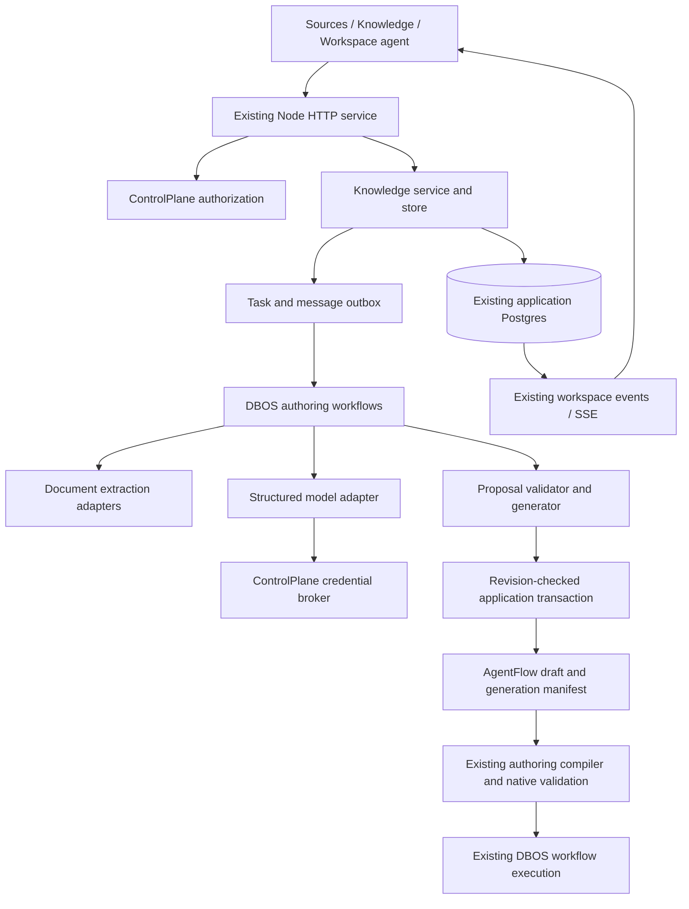

# Workspace intelligence: technical design

Status: proposed technical specification, 2026-10-19. Based on the current `apps/studio` working tree, including uncommitted changes. This is implementation planning, not implemented functionality. Product requirements are in [Workspace intelligence and domain ontology](workspace-intelligence.md).

Architecture update: [Ambient workspace agent harness](workspace-agent-harness.md) supersedes this document's task-centric orchestration direction. The knowledge/revision, provenance, connection and compiler foundations below remain relevant; the current document-analysis task is a transitional capability, not the ambient agent.

Implementation tracking: [delivered scope and limits](workspace-intelligence-implementation-notes.md). MiniMax is the selected first model provider; the broader delivery sequence below remains the target architecture.

## 1. Architecture decision

Add a workspace intelligence subsystem inside the existing Node service and Next application. Reuse Postgres, Zod, AJV, control-plane authorization, the credential broker, workspace SSE, and DBOS. Do not introduce a separate agent server, graph database, Rust/WASM runtime or replacement workflow editor for the first slice.

The subsystem has three representations with explicit boundaries:

1. **Knowledge:** versioned domain modules, process definitions and evidence.
2. **Generation proposal:** reviewed knowledge plus capability bindings and a proposed graph; may have unresolved requirements.
3. **Executable authoring artifact:** an ordinary `AgentFlow`, validated and snapshotted through the existing compiler/runtime.

Model responses are candidate structured data. They are never executable definitions, authorization grants or trusted registry entries.



## 2. Existing implementation: reuse and gaps

Paths below were inspected in this repository. A type or a connection form is not evidence of a working provider adapter.

| Existing code                                                                                                                   | Observed behavior                                                                                                                                                                                                                             | Technical consequence                                                                                                                              |
| ------------------------------------------------------------------------------------------------------------------------------- | --------------------------------------------------------------------------------------------------------------------------------------------------------------------------------------------------------------------------------------------- | -------------------------------------------------------------------------------------------------------------------------------------------------- |
| [`next.config.ts`](../../next.config.ts)                                                                                        | Rewrites `/api/*` to loopback port 3021; browser application runs separately on 3100.                                                                                                                                                         | Add knowledge routes to the Node service; do not build parallel Next API handlers.                                                                 |
| [`server/index.ts`](../../server/index.ts)                                                                                      | Initializes store/control/registry/runtime, launches DBOS, restores native schedules, reconciles work and starts workspace events.                                                                                                            | Register intelligence workflows before `DBOS.launch`; initialize knowledge storage after control schema; add a bounded reconciliation hook.        |
| [`server/http.ts`](../../server/http.ts)                                                                                        | Authenticated workspace context; writes default to `execute`; JSON request reader has a 1 MiB limit.                                                                                                                                          | New route family must select permissions explicitly. Document bytes need a separate bounded upload reader, not base64 JSON through `body()`.       |
| [`server/control/service.ts`](../../server/control/service.ts)                                                                  | `context`, `transaction`, `audit`, membership checks and worker-only `resolveCredential`.                                                                                                                                                     | Reuse request authorization and credential resolution; add a background-principal authorization entry point.                                       |
| [`server/control/auth.ts`](../../server/control/auth.ts)                                                                        | Sign-in and temporary credential resolvers are adapters.                                                                                                                                                                                      | Preserve the sign-in adapter boundary; do not confuse identity adapters with model adapters.                                                       |
| [`server/control/schema.sql`](../../server/control/schema.sql)                                                                  | Workspace roles, connections, audits, metadata events and notification reads; audit inserts publish committed workspace events.                                                                                                               | Knowledge mutations should audit in their transaction and use the same event stream.                                                               |
| [`server/control/events.ts`](../../server/control/events.ts)                                                                    | Postgres LISTEN plus persistent event replay; resource names currently join workflows, runs and connections.                                                                                                                                  | Add intelligence event titles/resource naming without exposing source content in notifications.                                                    |
| [`hooks/use-workspace-events.tsx`](../../hooks/use-workspace-events.tsx)                                                        | Shared SSE connection and coalesced refresh.                                                                                                                                                                                                  | Reuse for task progress; fetch authoritative task details after invalidation.                                                                      |
| [`server/store.ts`](../../server/store.ts)                                                                                      | Mutable graph JSON per saved flow; run rows contain graph snapshots. No saved-flow revision/CAS contract.                                                                                                                                     | Add flow edit revisions and CAS before applying proposals to an existing flow. Preserve run snapshots.                                             |
| [`lib/flows/types.ts`](../../lib/flows/types.ts), [`validation.ts`](../../lib/flows/validation.ts)                              | `AgentFlow` supports schema/authoring version 2, declarations, typed ports, child definitions and default input. Parse limits include 50 nodes. `sourceReference` is a string; node `sourceRef` only describes document/paragraph references. | Generate version-2 authored graphs. Add versioned provenance references, not unvalidated data in old source fields. Respect existing graph limits. |
| [`lib/authoring/contracts.ts`](../../lib/authoring/contracts.ts)                                                                | Typed declarations and ports; AJV validation with coercion/default insertion disabled and format validation disabled.                                                                                                                         | Reuse structural validation. Add explicit date/unit/currency semantics; a JSON Schema format label alone is not enforced.                          |
| [`lib/authoring/compiler.ts`](../../lib/authoring/compiler.ts), [`scoped-executor.ts`](../../lib/authoring/scoped-executor.ts)  | Authored parameters compile to bindings; scoped state and upstream references are checked.                                                                                                                                                    | Keep expressions and writes explicit; no generated JavaScript evaluation bypass.                                                                   |
| [`lib/authoring/expressions.ts`](../../lib/authoring/expressions.ts)                                                            | Restricted expression roots/helpers and literal property paths, not arbitrary JavaScript.                                                                                                                                                     | Generator emits supported expressions; model-authored expressions must parse and pass scope validation.                                            |
| [`server/native-runtime.ts`](../../server/native-runtime.ts)                                                                    | Compiles/seals authored graphs, validates handlers, expands child snapshots; DBOS steps, transactions, messages, waits, schedules and stable child IDs.                                                                                       | Reuse for generated workflow execution. The authoring agent itself should be a separately registered workflow with inspectable boundaries.         |
| [`server/registry.ts`](../../server/registry.ts)                                                                                | Trusted step/transaction/tool/model registration; legacy model execution consumes a node execution context.                                                                                                                                   | Reuse installed capability discovery, but define a dedicated structured authoring-model interface instead of manufacturing a legacy node/context.  |
| [`lib/integrations/model.ts`](../../lib/integrations/model.ts), [`catalog.ts`](../../lib/integrations/catalog.ts)               | Versioned schemas, connection validation and compilation to `integration.dispatch.v1`; catalog implementation status is `defined`.                                                                                                            | Add an installed adapter capability inventory/dispatcher. Never advertise all catalog entries as executable.                                       |
| [`components/control/shell.tsx`](../../components/control/shell.tsx), [`work-area.tsx`](../../components/control/work-area.tsx) | Shared workspace shell/work areas; `/flows` bypasses admin chrome.                                                                                                                                                                            | Add knowledge routes to the shell; preserve fullscreen canvas.                                                                                     |
| [`server/runtime.integration.test.ts`](../../server/runtime.integration.test.ts)                                                | Isolated Postgres/DBOS databases, fixture adapter and restart/recovery harness.                                                                                                                                                               | Extend this harness for authoring recovery, proposal conflicts and authorization.                                                                  |

Legacy comments in graph types reference files from earlier source projects that are absent here. In particular, existing `sourceRef`, `groundingKey` or model-profile fields do not constitute a document ingestion or intelligence subsystem.

## 3. Proposed module boundaries

All paths in this section are new unless explicitly marked as existing.

| Module                                                                        | Responsibility                                                                                       |
| ----------------------------------------------------------------------------- | ---------------------------------------------------------------------------------------------------- |
| `lib/knowledge/contracts.ts`                                                  | Zod envelopes for immutable revisions, provenance, lifecycle and diagnostics                         |
| `lib/knowledge/ontology.ts`                                                   | Domain module/entity/property/relationship schemas; structural validation and JSON Schema projection |
| `lib/knowledge/process.ts`                                                    | Process actions, decisions, control structures, roles, policy parameters and gaps                    |
| `lib/intelligence/contracts.ts`                                               | Task, question, proposal, binding and manifest DTOs                                                  |
| `lib/intelligence/generation.ts`                                              | Deterministic process-to-`AgentFlow` generation and traceability                                     |
| `lib/intelligence/validation.ts`                                              | Evidence, capability, mapping, scope and compilation validation; no network calls                    |
| `server/knowledge/store.ts`, `service.ts`, `routes.ts`                        | Workspace-scoped persistence, transactions, reviews and request handling                             |
| `server/knowledge/migrations/`                                                | Ordered subsystem SQL migrations and migration tracking                                              |
| `server/knowledge/documents/`                                                 | Blob store, upload validation, extraction adapters and block normalization                           |
| `server/intelligence/model.ts`                                                | Structured model adapter contract and installed model capabilities                                   |
| `server/intelligence/tools.ts`                                                | Authorized authoring tools and tool argument/result schemas                                          |
| `server/intelligence/workflows.ts`                                            | Registered DBOS ingestion/analysis/generation workflows                                              |
| `server/intelligence/reconcile.ts`                                            | Durable task dispatch, answer delivery and cancellation reconciliation                               |
| `server/intelligence/apply.ts`                                                | Atomic, idempotent, conflict-checked proposal application                                            |
| `components/knowledge/`, `components/intelligence/`                           | Work areas, editors, source viewer and structured proposal review                                    |
| `app/knowledge/page.tsx`, `app/sources/page.tsx`, `app/intelligence/page.tsx` | Thin client entry points using existing shell/access providers                                       |

Use `lib` for browser-safe schemas and pure logic; keep parsing workers, filesystem access, credentials and provider SDKs server-only. A browser must not import the server agent orchestrator.

## 4. Core versioned contracts

### 4.1 Artifact envelope

Every source/module/process/binding has a workspace-scoped stable artifact ID. Every persisted content revision is immutable, including candidate revisions; mutable heads point to revisions. This makes a proposal's base unambiguous while supporting editable drafts through successive candidate revisions.

Logical envelope:

```ts
type ArtifactRef = { artifactId: string; revisionId: string };
type RevisionEnvelope<T> = {
  schemaVersion: 1;
  artifactId: string;
  revisionId: string;
  parentRevisionId?: string;
  contentHash: string;
  content: T;
};
```

Workspace identity and actor IDs come from the server, not this submitted envelope. Hashes use a versioned canonical JSON representation: object keys sorted recursively, array order retained, valid JSON numbers only, SHA-256 digest. Original binary sources use their byte hash. Hash identity is not permission to fetch an artifact across workspaces.

Reviews refer to a specific revision hash. Publishing requires that exact reviewed revision; publishing creates/updates a published-head pointer without mutating revision content. A later edit does not erase prior review decisions or silently become published.

### 4.2 Evidence

```ts
type Evidence =
  | { kind: 'source'; revisionId: string; blockId: string; start?: number; end?: number; quoteHash?: string }
  | { kind: 'user'; decisionId: string }
  | { kind: 'inference'; taskId: string; explanation: string };
```

Offsets are Unicode code-point offsets into the immutable normalized block text, not byte or browser UTF-16 offsets. Shared conversion helpers are required for source highlighting. A source claim may cite several blocks. The validator verifies workspace membership, block existence, offsets and quote hash. No invented page locator is accepted.

Assertions, properties, relationships, steps and policies carry stable element IDs plus evidence references. Element renames retain IDs; deletion or merge produces an explicit impact report. Inference evidence is never promoted to source evidence by a model.

### 4.3 Ontology and process payloads

An ontology module has entities with typed properties and relationships with source/target IDs and min/max cardinality; `null` max means unbounded. Initial inheritance is single-parent and acyclic. The projection to port JSON Schema expands a bounded supported subset and resolves local references; remote `$ref`/ontology imports are not fetched during compilation.

Relationship cardinality checks validate the model and explicit mappings. Instance-level constraints cannot be claimed as enforced unless the necessary linked records were actually retrieved. Unit/currency annotations are not automatic conversions.

A process revision contains typed input/output, actions, decisions, branches, explicit foreach/parallel/repeat structures, policies, human responsibilities and unresolved issues. Actions reference required capability semantics, not invented implementation IDs. A process has deterministic control semantics before graph generation. Nested sub-processes retain their own contracts and IDs.

Source format adapters, ontology schema projection and process-to-graph generation each declare their own version. Changing an extractor or generator does not rewrite old revisions or manifests.

## 5. Persistence design

Use the application database. Never write custom application tables into DBOS's system database.

Proposed tables (names are implementation targets):

| Table                     | Important columns/constraints                                                                                                                   |
| ------------------------- | ----------------------------------------------------------------------------------------------------------------------------------------------- |
| `wi_artifacts`            | `(workspace_id,id)` PK; kind; name; candidate/published revision pointers; `edit_version bigint`; archive timestamp                             |
| `wi_revisions`            | `(workspace_id,id)` PK; artifact ID; parent; schema version; immutable JSONB; hash; actor/task IDs; created timestamp; composite FK to artifact |
| `wi_source_blobs`         | Workspace, source revision ID, internal blob key, byte hash, media type, bytes, extraction status/version; composite ownership FK               |
| `wi_source_blocks`        | Workspace, source revision ID, block ID, ordinal, normalized text, block kind, optional page/heading/table locator; unique revision+block ID    |
| `wi_evidence_links`       | Workspace, owning revision/element ID, typed evidence reference; owned revisions and source blocks validated                                    |
| `wi_decisions`            | Immutable user answer/review; actor, subject revision/hash, decision kind/content, task/question IDs                                            |
| `wi_tasks`                | Workspace/task ID; initiating user; state; current attempt; task edit version; pinned input revision refs; bounded budget; cancellation flag    |
| `wi_attempts`             | Task/attempt ID; DBOS workflow ID unique; model/policy/extractor versions; status, error code, timestamps                                       |
| `wi_messages`             | Task sequence, message kind and author; bounded content; question IDs/answers; durable artifact references                                      |
| `wi_proposals`            | Task; immutable candidate changes, expected base versions/hashes, validation report, status                                                     |
| `wi_applications`         | Workspace/proposal ID unique; application ID; resulting revision/flow IDs and versions; application timestamp                                   |
| `wi_dispatch_outbox`      | Stable dispatch ID; task/attempt; start/answer/cancel action; bounded payload refs; delivered timestamp                                         |
| `wi_generation_manifests` | Immutable manifest ID; source/process/ontology/binding refs; generator version; proposed graph hash; node/control-to-process/evidence mapping   |
| `studio_flow_revisions`   | Workspace/flow/revision key; immutable authored graph; optional manifest ID; content hash; actor/time                                           |

Add `studio_flows.edit_version bigint NOT NULL DEFAULT 1` and an optional current revision reference. Backfill a revision of every existing saved graph without changing graph semantics or run history. Use composite workspace FKs for all knowledge references, not globally resolvable IDs alone. Manifest/flow revision records survive saved-flow deletion; retain identity through revision records rather than cascading from `studio_flows`.

Index task status/updated time, source revision+ordinal, artifact name/kind, evidence targets and proposal/application keys. Bound list endpoints with cursor pagination from the start. First-slice retrieval can use Postgres text search over blocks and explicit knowledge references; embeddings and vector storage are optional later, not a correctness dependency.

Introduce a subsystem migration runner with version/checksum tracking and a startup advisory lock. Run it after existing application and control schema initialization and before task recovery. Do not rewrite all current bootstrap SQL as part of this feature. A failed migration prevents intelligence workers from starting; no requests should see half-created subsystem tables.

## 6. Source upload and extraction

### Upload protocol

`POST /api/knowledge/sources` accepts bounded JSON metadata and creates a source artifact plus pending revision. `PUT /api/knowledge/sources/:id/revisions/:revisionId/content` streams binary bytes with a declared media type and task-specific byte limit. `POST .../complete` verifies stored hash/length and atomically requests ingestion.

All three routes require editor authority and recheck source ownership. Upload tokens/IDs never replace membership checks. Generated storage keys contain server-owned workspace/revision IDs, never user filenames or absolute paths. Retries of identical content finalize idempotently; conflicting finalized bytes return 409. Abandoned staged uploads have a cleanup policy.

A `DocumentBlobStore` interface supports a private local directory for development and an external object-store implementation later. APIs resolve keys server-side and stream content with `nosniff` and safe download headers. HTML and active document content are never executed in the source viewer. Original bytes are not public static assets and are not exposed through Next's `public/` folder.

### Extraction contract

An extraction adapter receives a source reference and bounded parser settings; it returns normalized blocks, warnings, detected format and adapter version. Parsing runs outside the main HTTP event loop with time/memory/output limits. ZIP-based formats need limits on decompressed entries/bytes; MIME and file signatures are checked. No document-declared URL or external resource is automatically fetched.

Deliver text/Markdown first, then DOCX and text-based PDF under the same interface. Select and pin parser libraries during the implementation dependency review. An image-only PDF returns `ocr_required`; unsupported diagrams/tables produce explicit warnings and questions. Format support cannot be claimed until its fixture tests pass.

Persist extracted blocks and completion status atomically. Re-running with a changed extractor creates a new extraction revision with stable original-source linkage; it must not invalidate old block citations.

## 7. Model and capability adapters

### Structured authoring model

Add a dedicated adapter rather than extending `NodeRegistry.execute` with an invented `llm` node:

```ts
interface AuthoringModelAdapter {
  id: string;
  version: number;
  providers: readonly string[];
  capabilities: { structuredOutput: boolean; toolCalls: boolean };
  generate(
    request: {
      model: string;
      messages: readonly { role: 'system' | 'user' | 'assistant'; content: string }[];
      outputSchema: Record<string, unknown>;
      limits: { maxOutputTokens: number; timeoutMS: number };
      signal: AbortSignal;
    },
    credential: unknown,
  ): Promise<unknown>;
}
```

This is an illustrative interface; credential types will be narrowed per provider. Invocation context is constructed by trusted server code. Resolve the selected connection/revision and credentials inside the actual model-call step immediately before the external request. Never serialize credentials in DBOS arguments, results, errors or task records.

Validate responses with the exact Zod output schema and domain checks. Bound repair attempts; preserve a structured failure rather than accepting malformed output. A model provider response ID, requested/returned model identifiers, adapter version, usage metadata and redacted error classification are recorded. Provider alias names do not guarantee immutable model behavior.

The current connection providers and broker can be reused, but no current connection entry guarantees a structured model adapter is installed. Publish an installed-model capability descriptor. In a manual-only workspace, model actions show unavailable status while knowledge editing remains usable.

### Executable offering inventory

Merge public schemas from the integration catalog, core authoring definitions/native offerings and actual server adapter registrations into a server-owned descriptor. Include offering/version, shape, effect, boundary, compatible providers and executable/defined/unavailable status. Add registry introspection where necessary; do not infer installation from a graph or a connection record.

`compileIntegrationStep` expects `integration.dispatch.v1`, but the inspected code does not install a general live dispatcher. Implement and test that dispatcher before declaring integration-backed generated workflows executable. Canvas and agent tools must share its authorization and validation path.

## 8. Durable task protocol

Do not run the authoring agent as one giant DBOS step. Register versioned workflow functions before launch: ingestion, analysis/clarification and workflow generation. Use bounded per-model-call and per-extraction durable steps; human waits stay at workflow level.

1. API authenticates the user, validates source/knowledge references and selected model connection, and inserts task+attempt+start-outbox+audit in one transaction.
2. A reconciler dispatches a stable workflow ID derived from workspace/task/attempt. It marks delivery after DBOS accepts the start. A lost acknowledgement repeats the same ID rather than creating a second task.
3. Workflow loads pinned inputs, invokes extraction/model steps, validates candidates and stores immutable proposal revisions. Large source/response content is stored as protected application artifacts; DBOS checkpoints carry stable result references.
4. A clarification creates a question with a stable ID and transitions to waiting. An answer is persisted with its decision and delivery-outbox row in a transaction, then delivered via DBOS messaging with a stable deduplication ID.
5. `DBOS.recv` waits at workflow level. The workflow reloads the authoritative answer and verifies question/attempt IDs; duplicated or obsolete messages cannot apply twice.
6. A ready proposal is reviewed through the API. Application is a separate authorized transaction, never an external model side effect.

Use DBOS's already-used workflow/start/step/send/receive patterns; validate any new SDK call against the local SDK before implementation. Task attempts have bounded timeout, model calls, output size and cumulative token/cost budgets. Budget exhaustion is a resumable user-visible condition with a deliberate new attempt, not an infinite repair loop.

Cancellation persists a flag and wakes a waiting workflow through the same outbox. A running step gets cooperative abort where supported; no guarantee is made that an external provider cancels an already accepted request. Completed evidence remains; no new proposal is applied after cancellation. Retrying creates a new attempt linked to prior results and explicit reuse policy.

Background work stores initiating user/workspace IDs, not a browser cookie. Add `authorizePrincipal(userId, workspaceId, permission)` backed by current membership. Recheck before each new effect and within application transactions. A cached durable authorization result is not permission for a new external call after revocation. Changed connection revisions or lost membership suspend/fail the pending task without silently substituting another resource.

Restart recovery reconstructs registered definitions first, then reconciles pending starts/messages. Do not add intelligence tasks to `studio_runs` as fake business workflows; they have separate records and may link actual test executions.

## 9. Proposal generation and validation

### Candidate generation

The model proposes a process/binding plan in a restricted intermediate schema, not arbitrary `AgentFlow` JSON. Deterministic generation allocates stable node IDs from process element IDs, sets authored parameters/ports, creates explicit control structures and produces a traceability manifest. Positions are generated by the existing layout logic or a shared extracted pure layout function.

Generated graphs use `schemaVersion: 2` and `authoringVersion: 2`. The generator distinguishes input defaults, declaration initialization, node output bindings and explicit variable writes. There is no implicit “copy run input to every matching variable” behavior. Repeated writes are visible in the generation explanation.

For an unsupported business action, retain an unresolved requirement in the proposal/process. Do not insert a fake executable node or forge an operation handler to fit the graph schema. A partially mapped proposal can be saved and reviewed; it is not labelled a runnable workflow. Creating a complete ordinary graph draft requires all modeled graph elements to have supported representations.

### Ordered gates

1. Validate source references, evidence existence and accepted revision hashes.
2. Validate ontology IDs, inheritance, property schemas and relationships.
3. Validate process topology, policies, routes, termination and human-role bindings.
4. Validate semantic bindings: units/currency/cardinality, typed input/output mappings and effects.
5. Check offering/adapter installation and authorized compatible connection revisions.
6. Generate a graph within current size/depth limits and run `parseFlow`, `compileAuthoringGraph` and `validateFlow`.
7. Run `runtime.native.validate` for executable readiness, including actual handlers and child definitions. This may configure no external effect or schedule; keep readiness distinct from invocation.
8. Store validation report with stage, severity, element ID, node/field path and remediation target.

Current save routes can store incomplete authored drafts with diagnostics; that behavior does not prove executable readiness. No test execution, provider call or schedule activation is part of pure validation. A generated workflow starts with scheduling disabled unless separately configured through the existing explicit action.

Core pure workflows can prove the first generation slice without live integrations. A connected-domain demonstration must add the relevant executable adapter; deterministic fixtures must remain labelled fixtures.

## 10. Atomic application and graph revisioning

Add CAS to every saved-flow writer, not just the agent route. Otherwise the canvas could silently overwrite an agent-applied update. Extend list/get DTOs and `AgentFlow`/`flowSchema` with a server-owned edit version and optional manifest reference. Clients submit the expected version; server reads are authoritative. Do not trust a submitted workspace ID, hash or compiled snapshot.

Update `saveWorkflowDraft`, the main toolbar save, settings save and import/update routes together. Creates allocate version 1. Updates require an expected version; mismatch returns 409 plus current version, without mutating the graph. Backfilled flows remain readable. The rollout updates all bundled clients together; old clients attempting an update without a version receive a clear reload-required response.

Application transaction:

1. Authorize current actor; lock proposal and affected artifact/flow head rows in stable order.
2. If a successful application exists for this proposal, return its recorded receipt.
3. Verify proposal state, cancellation, expected base versions/hashes, selected published/reviewed revisions and validation dependencies.
4. Create immutable revisions and the graph/manifest link; update heads using CAS; insert the application receipt.
5. Insert bounded audit metadata in the same transaction and commit.

No provider call, DBOS start, parser or model invocation occurs inside this transaction. Schedule/test requests happen afterward through their existing explicit APIs. Database errors roll back all head changes. A conflicting application is a review/rebase action, not a forced overwrite.

Add `generationManifestId` to the authored graph envelope and explicitly preserve it through `flowSchema`, compilation, child snapshot capture and run graph snapshots. Node-level lineage stays in the immutable manifest, keyed by node ID. Do not overload the old `sourceRef` with a different schema. Source content and model transcripts do not travel inside run graph JSON.

If a user later edits the graph, a new flow revision retains origin lineage and records the fork/edit revision. The old manifest describes the original generation, not a claim that every current node still matches the process. A graph hash comparison and per-element mapping show drift. Existing saved-flow deletion must preserve flow revision/manifests and historical runs.

## 11. HTTP contracts and permissions

All paths are under the existing service and origin checks. Representative endpoints:

| Endpoint                                                              | Result / permission                                                                                  |
| --------------------------------------------------------------------- | ---------------------------------------------------------------------------------------------------- |
| `GET /api/knowledge/artifacts?kind=&cursor=`                          | Cursor-paginated authorized metadata; read                                                           |
| `POST /api/knowledge/artifacts`                                       | Create ontology/process draft; execute                                                               |
| `GET /api/knowledge/artifacts/:id/revisions/:revisionId`              | Authorized immutable revision; read                                                                  |
| `POST /api/knowledge/artifacts/:id/revisions`                         | New revision with expected head version; execute                                                     |
| `POST /api/knowledge/artifacts/:id/review`                            | Decision tied to revision hash; execute                                                              |
| `POST /api/knowledge/artifacts/:id/publish`                           | Publish reviewed revision; manage in initial policy                                                  |
| `POST /api/knowledge/sources` and upload protocol                     | Source intake and bounded bytes; execute                                                             |
| `GET /api/knowledge/sources/:id/revisions/:revisionId/blocks?cursor=` | Protected extracted blocks; read                                                                     |
| `GET /api/intelligence/capabilities`                                  | Installed, authorized model/operation descriptors; read                                              |
| `POST /api/intelligence/tasks`                                        | Return 202 task ID and attempt/status refs; execute                                                  |
| `GET /api/intelligence/tasks/:id`                                     | Bounded task detail; read                                                                            |
| `GET /api/intelligence/tasks/:id/messages?cursor=`                    | Cursor-paginated transcript/artifact refs; read                                                      |
| `POST /api/intelligence/tasks/:id/answers`                            | Expected task version, question ID and typed answers; execute                                        |
| `POST /api/intelligence/tasks/:id/cancel`                             | Idempotent cancellation request; execute                                                             |
| `GET /api/intelligence/proposals/:id`                                 | Structured diff, gaps and validation; read                                                           |
| `POST /api/intelligence/proposals/:id/apply`                          | Expected bases plus idempotency key; execute; any knowledge publication additionally requires manage |

Use existing read/execute/manage semantics initially: viewers inspect, editors author and create workflow drafts, owners/admins publish shared knowledge or manage connections. Reviewer independence and finer-grained source access are later policy decisions; do not imply a second-person review guarantee in this first policy. Authorized reviewers can record a review without authority to activate a schedule.

Introduce typed intelligence errors `{error, code, issues?, currentVersion?}` handled before the generic regex-based error classifier in `server/http.ts`. Use 409 for conflicts, 413 for uploads over limits, 415 for unsupported media, 422 for understood but invalid candidate data and 503 for unavailable required adapters. Foreign workspace resources return not-found rather than existence details.

## 12. Events, client state and UI integration

Emit metadata-only audit actions for source ingest status, review, proposal readiness/application and meaningful task state changes. Existing audit triggers create workspace events in the same commit. High-frequency token streaming is not part of this first protocol; status updates must not flood the permanent audit log.

Extend `WorkspaceEvents.list` resource naming, event titles and `notificationDestination` for source/artifact/task/proposal entity types. Use existing replay/read behavior; no second browser-wide event connection. An SSE event invalidates a bounded query. In-progress unsaved forms keep their local draft and show remote-change status rather than replacing user input on refresh.

`StackProcShell` currently special-cases `/flows` and assumes other content is workflows or `/control`. Add explicit page metadata/navigation entries for Sources, Knowledge and Workspace agent. Keep source and knowledge pages in the admin shell; keep workflow canvas untouched. Reuse `WorkArea`, official tables, `RecordAction`, `ControlModal`, shared inputs and tabs.

Knowledge tabs: ontology modules and processes with status/version search and header actions. Source viewer resolves a revision/block citation and provides readable text even when original preview is unavailable. Agent task surface shows conversation and the currently selected structured artifact/diff; only the content viewport scrolls. A draft has one clear apply action and a visible validation summary. Do not render business records as graph entities merely because their types exist in the ontology.

The canvas reads a manifest reference to offer “View source/process” and generation diagnostics. Reuse Input/Process/Output, Test & results and Help; do not add a second node configuration renderer. The same typed schema projection can later feed autocomplete, but full autocomplete implementation is a separate work item.

## 13. Test strategy and acceptance evidence

Pure tests:

- Canonical hashes, stable IDs, schema/provenance parsing and offset conversion.
- Ontology inheritance cycles, missing targets, cardinalities, unsupported formats and type projection.
- Process decisions/termination, unresolved policies, units/currency mismatches and role bindings.
- Deterministic node/control IDs, explicit variable writes, valid scoped expressions and manifest lineage.
- Missing adapter versus missing connection versus revoked/stale connection diagnostics.
- Invoice and unrelated-domain fixtures use identical generator code; unsupported requirements remain proposals.

Storage/service tests against isolated Postgres:

- Composite workspace ownership, foreign source/evidence/task IDs and viewer mutations.
- Concurrent canvas and proposal writes: exactly one wins CAS; no silent overwrite.
- Apply receipt idempotency, transaction rollback, stale reviews, cancelled tasks and deleted target flows.
- Flow revision backfill, legacy reads, generated manifest preservation through parse/compile/save/run snapshots and saved-flow deletion.
- Upload length/hash/type limits, parser limits, abandoned upload cleanup and protected source retrieval.

DBOS integration tests extend the existing restart harness:

- Crash after extraction/model completion: completed result is reused; no duplicate application.
- Crash between application commit and acknowledgement: same application receipt is returned.
- Start/message outbox retries, duplicate answers and waiting task recovery.
- Membership removal, connection revocation/revision change, cancellation and budget exhaustion between steps.
- Model/provider failure, malformed structured output and OCR-required states remain truthful.
- Workspace SSE replay contains correct task references and no source bodies or secrets.

Browser acceptance covers import → source citation → reviewed ontology/process → clarification → proposal → generated workflow draft. Test keyboard actions, header/tab/scroll ownership, square controls, loading/failure/conflict states, small viewports and fullscreen canvas handoff. Use disposable fixtures; do not mutate real customer access for visual QA.

Run targeted unit tests, isolated integration tests and `npm run build` for each relevant increment. A live-provider check is separate from deterministic fixture coverage and requires a configured customer-authorized model connection.

## 14. Implementation sequence and prerequisites

| Increment | Concrete deliverable                                                                            | Exit condition                                                                      |
| --------- | ----------------------------------------------------------------------------------------------- | ----------------------------------------------------------------------------------- |
| T1        | Pure contracts, two domain fixtures, canonical revision IDs/hashes and deterministic validation | Both fixtures validate; unsupported requirements are explicit; no AI dependency     |
| T2        | Knowledge migrations/store/routes, source upload/text extraction and manual authoring pages     | Workspace isolation, protected citations, revisions and review/publish tested       |
| T3        | Flow CAS/revisions and manifest preservation across all existing save paths                     | Concurrent updates cannot overwrite one another; old graphs/run snapshots preserved |
| T4        | Dedicated model adapter registry, task/outbox schema and DBOS task skeleton                     | Fixture model resumes after restart; no credential in checkpoints or streams        |
| T5        | Live structured extraction/clarification through one supported model connection                 | Evidence-backed proposals and paused/resumed questions work with bounded failures   |
| T6        | Binding planner, deterministic generation, atomic application and editor handoff                | Reviewed process produces a validated ordinary workflow draft with source lineage   |
| T7        | DOCX/PDF extraction adapters and one real domain operation adapter as needed                    | Document formats and connected execution pass their fixtures; no simulated success  |
| T8        | Bounded operational-agent generation and durable tool/model composition                         | Only after required workflow-capable adapters and tracing exist                     |

T2's initial format is deliberately text/Markdown, a smaller delivery increment than the product's complete initial-format target. DOCX/PDF support follows the same source contract. T3 must precede applying changes to existing workflows; create-only generation may be demonstrated earlier but must not be presented as safe collaborative editing.

Before T4/T5 implementation: select the first supported model adapter/provider, its request/response limits, credential handling and SDK dependency; select parser packages before T7. Before customer deployment: settle source retention, model data-handling policy and blob storage configuration. These decisions do not block T1/T2 manual foundations.

## 15. Non-goals and compatibility

No rewrites of the core interpreter, auth adapter system or existing canvas. No reliance on absent Stackproc reference-project modules named in legacy comments. No graph database, complete RDF/OWL reasoner, generic browser extension or Rust/WASM dependency in this delivery.

Ontology Playground remains a product/design reference. A separate source/license/schema assessment is required before adopting any of its code or RDF import/export logic. This technical spec proposes no such dependency.

Existing workflows remain runnable without ontology metadata. New knowledge validation is required only for workflows claiming a knowledge/generation manifest, and pinned published revisions never mutate an existing run. Human-built workflows continue to use the same compiler and runtime.
